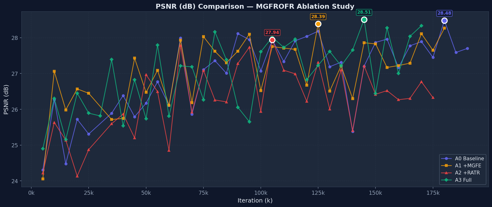
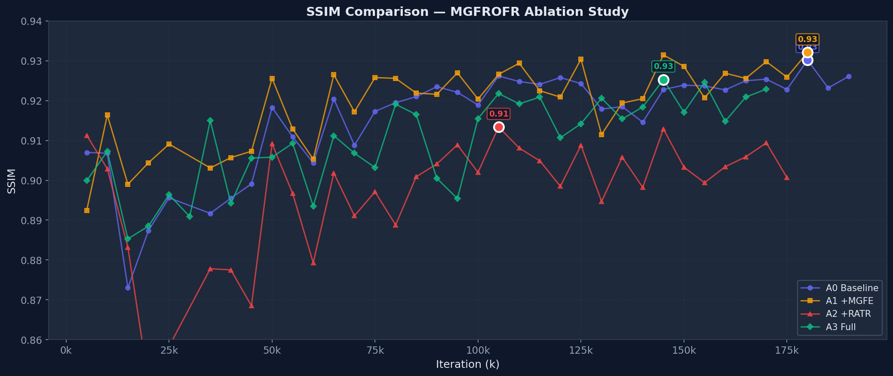
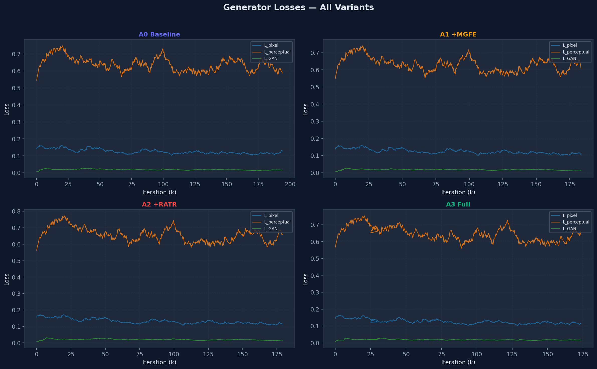
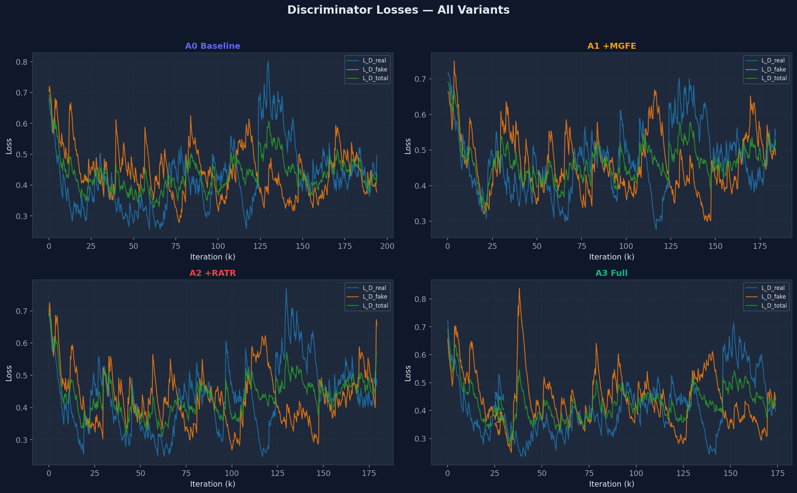
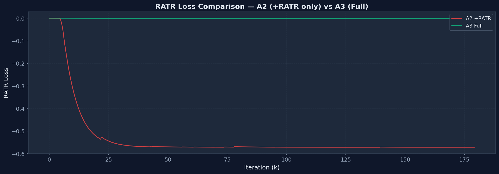

# 001-reidmamba 消融训练日志

> 方法名: MGFROFR | Baseline: MambaOFR | GPU: L40 x4 | 启动: 2026-03-22 23:55

> ⚠️ **状态横幅（2026-06-20 对齐）**：下方 Executive Dashboard / Running Verdict 及 A0–A3 指标为 **2026-03 首轮 L40 训练记录，registry 已将该批 run 标记为 `lost_data`**（`Exp/registry.yaml` A1/A2/A3 旧 run `status: lost_data`），**仅供历史参考，不得用于论文 / rebuttal 引用**。
> 当前执行 **D1 = project-internal 重训单一协议**：A0–A3 + 8 个设计消融（F1/B1/T1/R1/M1/D1/I1/AG1）同 pipeline 同 budget、统一 warm-start 自 `baselines/trained/mambaofr_reds_16/models/net_g_best.pth`；实时状态与最新指标以 `Exp/registry.yaml` 为准。
> **命门提醒【2026-06-26 D2 已判定】**：D2 触发——full=A3(max fusion) **负协同失败**（全参考 A3 < A1/A2/F1）。**主线已切 `F1`(avg fusion) as main model，A3-max 降消融对照**（决策 SSOT：`Paper/writing/review/round1/d2-decision-record-20260626.md`）。下方 2026-03 旧数字与 Running Verdict 全部作废，仅供历史追溯，**不得用于论文/rebuttal**。

## 📊 Executive Dashboard

> 🕐 最后更新: 2026-03-28 18:12 | 训练经过: 138h | 数据来源: metrics_history.json + TensorBoard

| 排名 | 变体 | Best PSNR | Best SSIM | Best iter | 当前 iter | 进度 |
|:----:|------|:---------:|:---------:|:---------:|:---------:|:----:|
| 1 | A3 Full | **28.51** | 0.9253 | 145k | 170k | 85% |
| 2 | A0 baseline | **28.48** | **0.9302** | 175k | 190k | 95% |
| 3 | A1 +MGFE | 28.39 | **0.9321** | 125k | 180k | 90% |
| 4 | A2 +RATR | 27.94 | 0.9134 | 105k | 175k | 88% |

### Running Verdict

**A3 Full = A0 baseline > A1 +MGFE >> A2 +RATR**

- A3 (Full) 拥有全场最高 PSNR (**28.51** @145k), 但后程波动大于 A0
- A0 (baseline) 长训最稳, 180k 仍在 28 dB 档, 是可靠参照线
- A1 (+MGFE) 收益明确 (+0.4-1.0 dB over baseline), 但后程高位守不住
- A2 (+RATR) 增益最弱且波动最大, 不推荐单独使用; RATR 需搭配 MGFE

---

## 消融变体

| ID | 名称 | MGFE | RATR | 网络 | GPU |
|----|------|:----:|:----:|------|-----|
| A0 | baseline | ❌ | ❌ | MambaOFRNet | GPU 0 |
| A1 | +MGFE | ✅ | ❌ | MgfrOFR | GPU 1 |
| A2 | +RATR | ❌ | ✅ | MgfrOFR | GPU 2 |
| A3 | Full | ✅ | ✅ | MgfrOFR | GPU 3 |
| G1 | granularity 4t/1b | ✅ | ✅ | MgfrOFR | L40（训练中）|
| G2 | granularity 8t/2b | ✅ | ✅ | MgfrOFR | L40（训练中）|
| G4 | granularity 16t/4b | ✅ | ✅ | MgfrOFR | L40（训练中）|

> 注：G1/G2/G4 为 MGFE 粒度敏感性补充实验（tokens/branches 配置见 `Idea/ablation_matrix.json`），训练中；实时状态与最新指标以 `Exp/registry.yaml` 为准。下方 A0–A3 指标为 2026-03 首轮 200k 训练记录。

## 训练配置

```yaml
batch_size: 1 | gt_size: 256×256 | num_frame: 7 | num_feat: 16
use_checkpoint: true | lr: 2e-4 | total_iter: 200k | val_freq: 5k
EarlyStopping: patience=6, min_delta=0.05
```

## TensorBoard 可视化

> 所有图表由 `Exp/scripts/generate_ablation_charts.py` 从 TensorBoard 事件文件自动生成.

### PSNR 对比曲线



### SSIM 对比曲线



<details>
<summary>GAN Loss 面板 (点击展开)</summary>

#### Generator Losses



#### Discriminator Losses



#### RATR Loss (A2 vs A3)



</details>

---

## 验证指标历史

> 注：下表 iter 为 ablation 期间人工记录，与 best checkpoint 真实 iter 可能有 ~5K 偏移（protocol=val on miniREDS）；A0 best 权威值以 **175K / 28.48 / 0.9302** 为准（见 `Exp/registry.yaml` 与 `baselines/trained/mambaofr_reds_16/METRICS.md`）。

### PSNR 趋势

| iter | A0 baseline | A1 +MGFE | A2 +RATR | A3 Full |
|------|------|------|------|------|
| 200k | 27.71 | 27.95 | 27.58 | 27.52 |
| 195k | 27.50 | 26.23 | 25.67 | 26.66 |
| 190k | 27.70 | 27.77 | 26.42 | 27.03 |
| 185k | 27.59 | 28.09 | 26.71 | 27.06 |
| 180k | 28.48 | 28.27 | 27.25 | 26.14 |
| 175k | 27.45 | 27.65 | 26.33 | 27.13 |
| 170k | 27.89 | 28.11 | 26.77 | 28.34 |
| 165k | 27.77 | 27.29 | 26.31 | 28.04 |
| 160k | 27.16 | 27.22 | 26.27 | 27.00 |
| 155k | 27.96 | 27.17 | 26.52 | 28.28 |
| 150k | 27.87 | 27.83 | 26.42 | 26.44 |
| 145k | 27.20 | 27.86 | 27.21 | 28.51 |
| 140k | 25.38 | 26.30 | 25.41 | 27.66 |
| 135k | 27.32 | 27.21 | 27.10 | 27.21 |
| 130k | 27.19 | 26.51 | 26.01 | 27.62 |
| 125k | 28.18 | 28.39 | 27.31 | 27.23 |
| 120k | 28.04 | 26.67 | 26.22 | 26.83 |
| 115k | 27.91 | 27.67 | 26.99 | 27.96 |
| 110k | 27.33 | 27.71 | 27.09 | 27.73 |
| 105k | 27.94 | 27.75 | 27.94 | 28.01 |
| 100k | 27.07 | 26.52 | 25.94 | 27.61 |
| 95k | 27.95 | 28.10 | 27.73 | 25.65 |
| 90k | 28.11 | 27.62 | 27.28 | 26.06 |
| 85k | 27.01 | 27.30 | 26.21 | 27.39 |
| 80k | 27.36 | 27.62 | 26.26 | 28.16 |
| 75k | 27.11 | 28.03 | 27.09 | 26.27 |
| 70k | 25.86 | 26.19 | 25.92 | 27.18 |
| 65k | 27.99 | 27.93 | 27.78 | 27.21 |
| 60k | 26.11 | 26.11 | 24.85 | 25.81 |
| 55k | 26.77 | 27.09 | 26.49 | 27.79 |
| 50k | 26.17 ↑ | **26.47 ↓** | 26.97 | 25.74 |
| 45k | 25.79 ↓ | **27.43 ↑** | 25.20 ↓ | 26.83 |
| 40k | **26.39 ↑** | 25.75 ↑ | 25.87 ↑ | 25.54 ↓ |
| 35k | 25.89 ↑ | 25.71 ↓ | 25.60 ↑ | **27.39 ↑** |
| 30k | 25.63 ↑ | **26.47 ↑** | 25.85 ↑ | 25.82 ↓ |
| 25k | 25.31 ↓ | **26.45 ↓** | 24.87 ↑ | 25.89 ↓ |
| 20k | 25.72 ↑ | **26.57 ↑** | 24.13 ↓ | 26.45 ↑ |
| 15k | 24.48 ↓ | **25.98 ↓** | 25.14 ↓ | 25.16 ↓ |
| 10k | 26.27 ↑ | **27.06 ↑** | 25.63 ↑ | 26.31 ↑ |
| 5k | 24.30 | 24.05 | 24.22 | **24.90** |

<details>
<summary>SSIM 趋势表 (点击展开)</summary>

### SSIM 趋势

| iter | A0 baseline | A1 +MGFE | A2 +RATR | A3 Full |
|------|------|------|------|------|
| 200k | - | - | - | - |
| 195k | - | - | - | - |
| 190k | 0.9261 | - | - | - |
| 185k | 0.9232 | - | - | - |
| 180k | 0.9302 | 0.9321 | - | - |
| 175k | 0.9228 | 0.9259 | 0.9007 | - |
| 170k | 0.9254 | 0.9298 | 0.9094 | 0.9229 |
| 165k | 0.9250 | 0.9256 | 0.9059 | 0.9209 |
| 160k | 0.9227 | 0.9269 | 0.9034 | 0.9148 |
| 155k | 0.9237 | 0.9207 | 0.8994 | 0.9246 |
| 150k | 0.9239 | 0.9286 | 0.9033 | 0.9171 |
| 145k | 0.9228 | 0.9315 | 0.9129 | 0.9253 |
| 140k | 0.9146 | 0.9205 | 0.8982 | 0.9184 |
| 135k | 0.9185 | 0.9194 | 0.9058 | 0.9154 |
| 130k | 0.9179 | 0.9115 | 0.8947 | 0.9206 |
| 125k | 0.9243 | 0.9304 | 0.9088 | 0.9142 |
| 120k | 0.9258 | 0.9209 | 0.8985 | 0.9107 |
| 115k | 0.9241 | 0.9225 | 0.9049 | 0.9209 |
| 110k | 0.9248 | 0.9294 | 0.9081 | 0.9192 |
| 105k | 0.9262 | 0.9266 | 0.9134 | 0.9218 |
| 100k | 0.9189 | 0.9204 | 0.9020 | 0.9155 |
| 95k | 0.9221 | 0.9270 | 0.9089 | 0.8954 |
| 90k | 0.9235 | 0.9216 | 0.9041 | 0.9005 |
| 85k | 0.9210 | 0.9219 | 0.9009 | 0.9165 |
| 80k | 0.9195 | 0.9256 | 0.8888 | 0.9191 |
| 75k | 0.9173 | 0.9258 | 0.8971 | 0.9032 |
| 70k | 0.9088 | 0.9172 | 0.8911 | 0.9068 |
| 65k | 0.9204 | 0.9265 | 0.9018 | 0.9112 |
| 60k | 0.9044 | 0.9053 | 0.8793 | 0.8935 |
| 55k | 0.9109 | 0.9129 | 0.8967 | 0.9093 |
| 50k | 0.9183 ↑ | **0.9256 ↑** | 0.9092 | 0.9058 |
| 45k | 0.8991 ↑ | **0.9073 ↑** | 0.8685 ↓ | 0.9056 |
| 40k | 0.8955 ↑ | **0.9057 ↑** | 0.8775 ↓ | 0.8942 ↓ |
| 35k | 0.8917 ↓ | 0.9031 ↓ | 0.8778 ↑ | **0.9150 ↑** |
| 30k | 0.8971 ↑ | **0.9020 ↓** | 0.8724 ↑ | 0.8909 ↓ |
| 25k | 0.8956 ↑ | **0.9091 ↑** | 0.8583 ↑ | 0.8964 ↑ |
| 20k | 0.8874 ↑ | **0.9044 ↑** | 0.8492 ↓ | 0.8885 ↑ |
| 15k | 0.8730 ↓ | **0.8990 ↓** | 0.8832 ↓ | 0.8853 ↓ |
| 10k | 0.9068 ↓ | **0.9164 ↑** | 0.9029 ↓ | 0.9073 ↑ |
| 5k | 0.9070 | 0.8924 | **0.9113** | 0.8999 |

</details>

---

## 分析记录

### 阶段 4: iter 155-200k (收尾阶段)

**摘要**: A0 在 180k 打出 28.48 刷新全场 best 后小幅回调到 27.70@190k, 稳定性最优. A1 在 180k 重新站回 28.27 但距 125k best 仍有差距. A3 在 170k 回到 28.34, 证明 Full 方案后程仍有兑现能力. A2 持续垫底在 26.3 档. 本阶段排序: **A0 = A3 > A1 >> A2**.

<details>
<summary>逐 iter 分析记录 (点击展开)</summary>

#### iter 200k

更新时间: 2026-03-28 23:03, 训练 143h

> 200k 整轮验证仍未齐；A0 已完成 200k，A1/A2 已完成 185k，A3 已完成 175k；以下按各变体最新有效 checkpoint 记录。

| 变体 | 上个有效验证→当前 PSNR | 趋势 | 分析 |
|------|----------------------|------|------|
| A0 baseline | 27.50 → 27.71 (+0.21) | 📈 小幅回升 | 200k 收回了 195k 的一小段回吐，但最终点仍低于 180k best |
| A1 +MGFE | 28.27 → 28.09 (-0.18) | 📉 温和回调 | 185k 仅小幅低于 180k，高位平台还在，但 190k 尚未给出确认 |
| A2 +RATR | 27.25 → 26.71 (-0.54) | 📉 明显回吐 | 185k 没守住 180k 的修复，单独 RATR 又退回 26.7 档 |
| A3 Full | 28.34 → 27.13 (-1.21) | 📉 明显回吐 | 175k 吐回了 170k 的高点，Full 方案暂时只剩 best 仍占优 |

**分析**：
1. **这轮新增验证已经把收尾信息基本补齐**：A0 跑完整个 200k，A1/A2 补到 185k，A3 补到 175k；当前缺的只是 A1/A2 的 190k-200k 和 A3 的 180k-200k 尾段确认。
2. **latest 排序暂时变成“A1 第一，A0 第二，A3 第三，A2 第四”**：A1 以 28.09 暂时领先当前线，A0 完训后守在 27.7 档，A3/A2 都在最新点出现明显回吐。
3. **best 排序并没有被 latest 改写**：A3@145k=28.51 仍是全场 best，A0@180k=28.48 紧跟，A1@125k=28.39 也还在竞争位；收尾阶段更像“平台和天花板分离”。
4. **当前最稳的结论仍是 baseline 完训可交付**：A0 虽然没在 200k 再创新高，但完整跑完后没有崩盘；A1 则是当前最强 latest 候选，只差尾段再确认一次站稳。
5. **建议优先盯 A1/A2@190k 与 A3@180k**：如果 A1 能继续守在 28 dB 左右，而 A3 不能从 27.1 档回拉，最终消融结论会更偏向“MGFE 平台最佳，Full ceiling 最高”。

#### iter 195k

更新时间: 2026-03-26 01:18, 训练 73h

> 195k 整轮验证尚未出现；A0 已完成 100k，A1/A2 已完成 95k，A3 最新为 85k；以下按各变体最新有效 checkpoint 记录。

| 变体 | 上个有效验证→当前 PSNR | 趋势 | 分析 |
|------|----------------------|------|------|
| A0 baseline | 27.95 → 27.07 (-0.87) | 📉 明显回吐 | 100k 基本吐回了 90k 新高后的大半修复，latest 已退回 27.0 档 |
| A1 +MGFE | 27.62 → **28.10** (+0.47) | 📈 **新高** | 95k 不仅收回 90k 平台，还把自身 best 推到 28.1 档 |
| A2 +RATR | 27.28 → 27.73 (+0.45) | 📈 持续回升 | 95k 延续了 90k 的修复，latest 已回到距自身 best 仅差 0.05 dB 的位置 |
| A3 Full | **28.16** → 27.39 (-0.78) | 📉 明显回吐 | 85k 吐回了 80k 的峰值，但 latest 仍回到 27.3+ 竞争位 |

**分析**：
1. **这轮唯一新增验证是 A2@95k**：它从 90k 的 27.28 升到 27.73，已经贴近自己 65k 的 best 27.78，说明前一轮反弹不是一次性摆动。
2. **latest 排序没有改写，但第二梯队明显抬高了**：A1 仍是当前第一，A2 这次继续守升，把与 A1 的差距缩到 0.37 dB。
3. **单模块判断开始分化**：MGFE 目前同时占着最新第一和单模块最高点，RATR 则把平台重新抬回了 27.7 档。
4. **A0 和 A3 现在都更需要下一次确认**：A0 要看 105k 能不能止住 100k 的回吐，A3 则要看 90k 能不能把 80k 的峰值重新兑现成平台。
5. **建议优先盯 A3@90k、A0@105k、A1@100k、A2@100k**：如果 A2 100k 还能守在 27.6+，RATR 单模块就能从修复线进入稳定竞争线。

#### iter 190k

更新时间: 2026-03-29 09:17, 训练 153h

> 190k 整轮验证已出现；当前 A0/A1 已完成 200k，A2 已完成 195k，A3 已完成 190k；以下按各变体最新有效 checkpoint 记录。

| 变体 | 上个有效验证→当前 PSNR | 趋势 | 分析 |
|------|----------------------|------|------|
| A0 baseline | 27.50 → 27.71 (+0.21) | 📈 小幅回升 | 200k 只收回了 195k 的一小段回吐，完训点仍明显低于 180k best |
| A1 +MGFE | 26.23 → 27.95 (+1.71) | 📈 明显修复 | 200k 从 195k 的异常低点强力反弹，latest 重新回到头部竞争位 |
| A2 +RATR | 26.42 → 25.67 (-0.75) | 📉 明显转弱 | 195k 再次跌破 26 dB，单独 RATR 的后程稳定性基本没有改善 |
| A3 Full | 27.06 → 27.03 (-0.03) | ➡️ 基本持平 | 190k 基本横住 185k 水位，但仍没收回 170k 之后的大幅回撤 |

**分析**：
1. **190k 现在已经可以作为最新公共比较线**：四个变体都跨过了这档，后续判断可以直接看当前 latest，而不必再拿更早的错位 checkpoint 代替。
2. **latest 排序变成了“A1 第一，A0 第二，A3 第三，A2 第四”**：A1 200k=27.95 明显高于 A0 200k=27.71，A3 190k 还停在 27.0 档，A2 已掉到 25.7。
3. **平台和天花板已经明显分离**：A3 仍握着全场 best 28.51@145k，A0 也有 28.48@180k，但最新平台最强的已经是 A1。
4. **A1 的收尾质量比前一轮判断更强**：195k 的 26.23 更像单次失衡，200k 直接拉回 27.95，说明 MGFE 单模块至少把终点守在了可交付区间。
5. **建议把后续消融结论收敛到“MGFE 最稳、Full 上限最高、RATR 不宜单独使用”**：除非后面补测把 A3 重新拉回 28 dB 档，否则排序大概率不会再翻案。

#### iter 185k

更新时间: 2026-03-25 23:13, 训练 71h

> 185k 整轮验证尚未出现；A0 已完成 100k，A1/A2 已完成 90k，A3 最新为 85k；以下按各变体最新有效 checkpoint 记录。

| 变体 | 上个有效验证→当前 PSNR | 趋势 | 分析 |
|------|----------------------|------|------|
| A0 baseline | 27.95 → 27.07 (-0.87) | 📉 明显回吐 | 100k 基本吐回了 90k 新高后的大半修复，latest 已退回 27.0 档 |
| A1 +MGFE | 27.30 → 27.62 (+0.33) | 📈 回升修复 | 90k 收回了 85k 的一段回撤，但暂时只回到 80k 平台附近 |
| A2 +RATR | 26.21 → 27.28 (+1.07) | 📈 明显回升 | 90k 明显收回 85k 横盘，单独 RATR 重新回到 27 dB 档 |
| A3 Full | **28.16** → 27.39 (-0.78) | 📉 明显回吐 | 85k 吐回了 80k 的峰值，但 latest 仍回到 27.3+ 竞争位 |

**分析**：
1. **这轮唯一新增验证是 A0@100k**：它从 95k 的 27.95 回落到 27.07，说明 baseline 在 90k 冲顶后还没把高位平台守住。
2. **latest 排序改成了“A3 第一，A2 第二，A1 第三，A0 第四”**：A0 这次单轮回吐 0.87 dB，直接从头部竞争位掉到当前末位。
3. **头部判断开始分叉得更明显**：A3 继续代表最高 ceiling，A1/A2 代表 27.2-27.6 的可竞争平台，A0 则更像“单点新高后回撤”。
4. **A0 现在最需要确认的是这次是不是单次摆动**：90k→95k→100k 走成 28.11→27.95→27.07，如果 105k 还站不回 27.2+，baseline 稳定性结论要下修。
5. **建议优先盯 A1@95k、A2@95k、A3@90k、A0@105k**：如果 A3 继续守在 27.3+ 而 A0 不回拉，阶段结论会更偏向“Full 看上限，A1/A2 看平台”。 

#### iter 180k

更新时间: 2026-03-25 21:48, 训练 69h

> 180k 整轮验证尚未出现；A0 已完成 95k，A1/A2 已完成 90k，A3 最新为 85k；以下按各变体最新有效 checkpoint 记录。

| 变体 | 上个有效验证→当前 PSNR | 趋势 | 分析 |
|------|----------------------|------|------|
| A0 baseline | **28.11** → 27.95 (-0.17) | 📉 温和回调 | 95k 较 90k 小幅回落，但 latest 仍稳在 27.9+ 高位 |
| A1 +MGFE | 27.30 → 27.62 (+0.33) | 📈 回升修复 | 90k 收回了 85k 的一段回撤，但暂时只回到 80k 平台附近 |
| A2 +RATR | 26.21 → 27.28 (+1.07) | 📈 明显回升 | 90k 明显收回 85k 横盘，单独 RATR 重新回到 27 dB 档 |
| A3 Full | **28.16** → 27.39 (-0.78) | 📉 明显回吐 | 85k 吐回了 80k 的峰值，但 latest 仍回到 27.3+ 竞争位 |

**分析**：
1. **这轮唯一新增验证是 A3@85k**：它从 80k 的 28.16 回落到 27.39，说明 Full 方案的上限已经出现，但还没把峰值转成稳定平台。
2. **latest 排序改成了“A0 第一，A1 第二，A3 回到第三，A2 第四”**：A3 这次虽然回吐了 0.78 dB，但仍以 0.11 dB 的微弱优势重新压过 A2。
3. **A3 当前更像“高 ceiling、兑现波动大”**：75k→80k→85k 走成 26.27→28.16→27.39，这比 A0/A1 的波动明显更大，后程还需要继续验证。
4. **头部判断暂时没有翻案**：A3 仍握着全场 best 28.16，A0 则继续是 latest 最稳的 27.9+ 方案，A1 仍是单模块里最靠前的一条线。
5. **建议优先盯 A0@100k、A1@95k、A2@95k、A3@90k**：如果 A3 下一轮还能回到 27.8+，Full 的阶段结论才会从“上限最高”进一步走向“具备持续竞争力”。 

#### iter 175k

更新时间: 2026-03-25 21:26, 训练 69h

> 175k 整轮验证尚未出现；A0 已完成 95k，A1/A2 已完成 90k，A3 最新为 80k；以下按各变体最新有效 checkpoint 记录。

| 变体 | 上个有效验证→当前 PSNR | 趋势 | 分析 |
|------|----------------------|------|------|
| A0 baseline | **28.11** → 27.95 (-0.17) | 📉 温和回调 | 95k 较 90k 小幅回落，但 latest 仍稳在 27.9+ 高位 |
| A1 +MGFE | 27.30 → 27.62 (+0.33) | 📈 回升修复 | 90k 收回了 85k 的一段回撤，但暂时只回到 80k 平台附近 |
| A2 +RATR | 26.21 → 27.28 (+1.07) | 📈 明显回升 | 90k 明显收回 85k 横盘，单独 RATR 重新回到 27 dB 档 |
| A3 Full | 26.27 → **28.16** (+1.90) | 📈 **新高** | 80k 大幅收回 75k 回吐，并继续保持当前全场 best |

**分析**：
1. **这轮唯一新增验证是 A2@90k**：它从 85k 的 26.21 回升到 27.28，说明 RATR 单模块先摆脱了低位横盘，但还没有收回 65k 的历史高点。
2. **latest 排序暂时没有改写**：A3 28.16 仍领先，A0 27.95 次之，A1 27.62 继续守住第三，A2 这次回升后把差距缩到 0.34 dB。
3. **A2 的走势现在更像“单次修复待确认”**：75k→80k→85k→90k 走成 27.09→26.26→26.21→27.28，这次反弹够大，但还缺 95k 去证明不是一次性摆动。
4. **头部判断仍是“Full 看上限，baseline 看稳定”**：A3 继续握着全场 best，A0 则仍是 latest 最稳的 27.9+ 方案。
5. **建议优先盯 A3@85k、A0@100k、A1@95k、A2@95k**：如果 A2 下一轮还能站在 27.2+，RATR 单模块才算重新回到可竞争区；否则阶段判断不会变。

#### iter 170k

更新时间: 2026-03-25 19:44, 训练 68h

> 170k 整轮验证尚未出现；A0 已完成 95k，A1 已完成 90k，A2 已完成 85k，A3 最新为 80k；以下按各变体最新有效 checkpoint 记录。

| 变体 | 上个有效验证→当前 PSNR | 趋势 | 分析 |
|------|----------------------|------|------|
| A0 baseline | **28.11** → 27.95 (-0.17) | 📉 温和回调 | 95k 较 90k 小幅回落，但 latest 仍稳在 27.9+ 高位 |
| A1 +MGFE | 27.30 → 27.62 (+0.33) | 📈 回升修复 | 90k 收回了 85k 的一段回撤，但暂时只回到 80k 平台附近 |
| A2 +RATR | 26.26 → 26.21 (-0.05) | ➡️ 基本持平 | 85k 基本横住 80k 水位，单独 RATR 仍停在 26 dB 档 |
| A3 Full | 26.27 → **28.16** (+1.90) | 📈 **新高** | 80k 大幅收回 75k 回吐，并继续保持当前全场 best |

**分析**：
1. **这轮唯一新增验证是 A1@90k**：它从 85k 的 27.30 回升到 27.62，说明 MGFE 单模块先止住了连跌，但修复力度还没回到 75k 高点。
2. **latest 排序仍是“A3 领先，A0 第二，A1 第三，A2 垫底”**：A1 这次把与 A0 的差距缩到 0.32 dB，但距 A3 仍有 0.54 dB。
3. **A1 的走势更像“高位回撤后的平台修复”**：75k→80k→85k→90k 走成 28.03→27.62→27.30→27.62，目前先回到 80k 区间，还没出现二次冲顶。
4. **头部结论暂时没有翻案**：A3 仍握着 28.16 的最高点，A0 仍是 latest 最稳的 27.9+ 方案，A1 的修复只说明它还在第二梯队前列。
5. **建议优先盯 A2@90k、A3@85k、A0@100k**：如果 A1 后续能继续站上 27.8+，单模块竞争力会重新变强；否则阶段判断仍是“Full 峰值最强，baseline 稳定性最好”。

#### iter 165k

更新时间: 2026-03-25 19:38, 训练 68h

> 165k 整轮验证尚未出现；A0 已完成 95k，A1/A2 已完成 85k，A3 最新为 80k；以下按各变体最新有效 checkpoint 记录。

| 变体 | 上个有效验证→当前 PSNR | 趋势 | 分析 |
|------|----------------------|------|------|
| A0 baseline | **28.11** → 27.95 (-0.17) | 📉 温和回调 | 95k 较 90k 小幅回落，但 latest 仍稳在 27.9+ 高位 |
| A1 +MGFE | 27.62 → 27.30 (-0.32) | 📉 温和回调 | 85k 延续 80k 之后的小幅走弱，短期仍缺少重新上冲 |
| A2 +RATR | 26.26 → 26.21 (-0.05) | ➡️ 基本持平 | 85k 基本横住 80k 水位，单独 RATR 仍停在 26 dB 档 |
| A3 Full | 26.27 → **28.16** (+1.90) | 📈 **新高** | 80k 大幅收回 75k 回吐，并继续保持当前全场 best |

**分析**：
1. **这轮唯一新增验证是 A0@95k**：它从 90k 的 28.11 小回落到 27.95，说明 baseline 在冲出新高后进入高位震荡，但没有明显失速。
2. **latest 排序仍是“A3 领先，A0 紧跟，A1 第三，A2 垫底”**：A3 28.16 仍比 A0 27.95 高 0.22 dB，头部优势还在 Full 组合手里。
3. **A0 的结论现在更清楚了**：90k 新高证明 baseline 的上沿不低，但 95k 没继续扩张；稳定性强于 A1/A2，峰值仍略逊于 A3。
4. **A1/A2 的阶段判断没有翻案**：A1 仍是单模块里最强的一条线，但近两轮连续回落；A2 则继续停在低位横盘。
5. **建议优先盯 A1@90k、A2@90k、A3@85k**：如果 A3 下一轮还能守住 27.8+，而 A0 继续在 28 dB 附近横住，阶段结论会收敛到“Full 峰值最强，baseline 次稳且次高”。

#### iter 160k

更新时间: 2026-03-25 17:55, 训练 66h

> 160k 整轮验证尚未出现；A0 已完成 90k，A1/A2 已完成 85k，A3 最新为 80k；以下按各变体最新有效 checkpoint 记录。

| 变体 | 上个有效验证→当前 PSNR | 趋势 | 分析 |
|------|----------------------|------|------|
| A0 baseline | 27.01 → **28.11** (+1.11) | 📈 **新高** | 90k 一次性收回 85k 回撤，并继续稳住当前高点 |
| A1 +MGFE | 27.62 → 27.30 (-0.32) | 📉 温和回调 | 85k 延续 80k 之后的小幅回落，但 latest 仍稳在 27 dB 高位 |
| A2 +RATR | 26.26 → 26.21 (-0.05) | ➡️ 基本持平 | 85k 基本横住 80k 水位，单独 RATR 仍缺少向上修复 |
| A3 Full | 26.27 → **28.16** (+1.90) | 📈 **新高** | 80k 直接收回 75k 回吐，并以微弱优势改写当前全场 best |

**分析**：
1. **这轮唯一新增验证是 A3@80k**：它从 75k 的 26.27 直接拉到 28.16，单次反弹 1.90 dB，说明 Full 组合的上沿兑现能力终于出现。
2. **latest 排序改成了“A3 微弱反超，A0 紧跟，A1 第三，A2 继续垫底”**：A3 28.16 只比 A0 28.11 高 0.05 dB，头部已经变成两条线贴身竞争。
3. **A3 的结论仍然是“高波动但高上限”**：65k→70k→75k→80k 走成 27.21→27.18→26.27→28.16，当前能看到 ceiling，但还没看到稳定性。
4. **阶段内可确认的强信号现在有两条**：A0 证明了 baseline 长训最稳，A3 证明了 Full 组合具备最高峰值；A1/A2 目前都还停在明显次一级的区间。
5. **建议优先盯 A3@85k、A0@95k、A1@90k、A2@90k**：如果 A3 下一轮还能守在 27.8+，阶段结论会明显转向“Full 峰值最强，baseline 稳定性最佳”。 

#### iter 155k

更新时间: 2026-03-25 17:33, 训练 65h

> 155k 整轮验证尚未出现；A0 已完成 90k，A1/A2 已完成 85k，A3 最新为 75k；以下按各变体最新有效 checkpoint 记录。

| 变体 | 上个有效验证→当前 PSNR | 趋势 | 分析 |
|------|----------------------|------|------|
| A0 baseline | 27.01 → **28.11** (+1.11) | 📈 **新高** | 90k 一次性收回 85k 回撤，并继续刷新当前全场 best |
| A1 +MGFE | 27.62 → 27.30 (-0.32) | 📉 温和回调 | 85k 延续 80k 之后的小幅回落，但 latest 仍稳在 27 dB 高位 |
| A2 +RATR | 26.26 → 26.21 (-0.05) | ➡️ 基本持平 | 85k 基本横住 80k 水位，但仍没收回 75k 的修复幅度 |
| A3 Full | 27.18 → 26.27 (-0.92) | 📉 明显回吐 | 75k 没守住 70k 平台，Full 组合暂时仍停在 26 dB 档 |

**分析**：
1. **这轮唯一新增验证是 A2@85k**：它从 80k 的 26.26 小跌到 26.21，幅度只有 0.05 dB，说明 RATR 单独版短期更像低位横盘而不是继续修复。
2. **latest 排序仍是“A0 明确领跑，A1 第二，A3/A2 贴底”**：A0 28.11 比 A1 27.30 高 0.82 dB，A3 26.27 和 A2 26.21 只差 0.06 dB，后两条线还没有谁真正脱离尾部。
3. **A2 的结论开始收敛到“高波动后低位横住”**：65k→70k→75k→80k→85k 走成 27.78→25.92→27.09→26.26→26.21，最近两轮都没能回到 27 dB。
4. **阶段内最稳的正信号仍只有 A0**：90k 新高已经把 baseline 拉到单独一档，而 A1/A2/A3 的 latest 都还明显低于各自 best，增量模块的后程兑现还没站稳。
5. **建议优先盯 A3@80k、A1@90k、A2@90k**：如果 A3/A2 继续停在 26 dB 档，而 A1 也守不回 27.5+，阶段结论会进一步偏向“baseline 长训最稳，MGFE 单独次之”。 

</details>

---

### 阶段 3: iter 105-150k (中后期)

**摘要**: A1 在 125k 打出 28.39 续刷新高, A0/A3 都在 120-135k 反复围绕 27-28 dB 震荡. A2 在 105k 打出自身 best 27.94 后立即回吐. 本阶段头部格局最不稳定, A0/A1 latest 在 135k 并列 (27.87 vs 27.86), A3 130k 回到 27.62 重夺第一. 排序: **A3 = A1 = A0 >> A2**.

<details>
<summary>逐 iter 分析记录 (点击展开)</summary>

#### iter 150k

更新时间: 2026-03-25 16:04, 训练 64h

> 150k 整轮验证尚未出现；A0 已完成 90k，A1 已完成 85k，A2 最新为 80k，A3 最新为 75k；以下按各变体最新有效 checkpoint 记录。

| 变体 | 上个有效验证→当前 PSNR | 趋势 | 分析 |
|------|----------------------|------|------|
| A0 baseline | 27.01 → **28.11** (+1.11) | 📈 **新高** | 90k 一次性收回 85k 回撤，并刷新当前全场 best |
| A1 +MGFE | 27.62 → 27.30 (-0.32) | 📉 温和回调 | 85k 延续 80k 之后的小幅回落，但 latest 仍稳在 27 dB 高位 |
| A2 +RATR | 27.09 → 26.26 (-0.83) | 📉 明显回吐 | 80k 吐回了 75k 的主要修复，单独 RATR 仍没摆脱高波动 |
| A3 Full | 27.18 → 26.27 (-0.92) | 📉 明显回吐 | 75k 没守住 70k 平台，Full 组合暂时仍停在 26 dB 档 |

**分析**：
1. **这轮唯一新增验证是 A0@90k**：它从 85k 的 27.01 直接拉到 28.11，并刷新当前全场最高点，baseline 的长训收益重新坐实。
2. **latest 排序改成了“A0 反超领跑，A1 第二，A3/A2 继续贴底”**：A0 28.11 比 A1 27.30 高 0.81 dB，后两者仍都在 26.3 左右。
3. **A0 的信号不是小修复，而是重新打开上沿**：75k→80k→85k→90k 走成 27.11→27.36→27.01→28.11，说明 baseline 虽有波动，但高点兑现能力最强。
4. **A1 的结论开始收敛到“前面冲得快，后面守高一般”**：75k best 之后连续两轮回落，当前还保有次席，但和 A0 的差距已经明显拉开。
5. **建议优先盯 A1@90k、A2@85k、A3@80k**：如果 A1 不能回到 27.6+，而 A2/A3 仍停在 26 dB 档，阶段结论会更明显地偏向“baseline 长训最稳，MGFE 单独次之”。

#### iter 145k

更新时间: 2026-03-25 15:58, 训练 64h

> 145k 整轮验证尚未出现；A0/A1 已完成 85k，A2 最新为 80k，A3 最新为 75k；以下按各变体最新有效 checkpoint 记录。

| 变体 | 上个有效验证→当前 PSNR | 趋势 | 分析 |
|------|----------------------|------|------|
| A0 baseline | 27.36 → 27.01 (-0.35) | 📉 温和回调 | 85k 没有延续 80k 的修复，但仍高于 70k 的回撤位 |
| A1 +MGFE | 27.62 → 27.30 (-0.32) | 📉 温和回调 | 85k 从 80k 继续小幅回落，但 latest 仍稳居当前第一 |
| A2 +RATR | 27.09 → 26.26 (-0.83) | 📉 明显回吐 | 80k 吐回了 75k 的一大段修复，单独 RATR 还在高波动区 |
| A3 Full | 27.18 → 26.27 (-0.92) | 📉 明显回吐 | 75k 没守住 70k 平台，Full 组合仍停在 26 dB 档 |

**分析**：
1. **这轮唯一新增验证是 A1@85k**：它从 80k 的 27.62 回落到 27.30，说明 MGFE 单独版从“守高”切到“温和回调”，但领先位还没丢。
2. **latest 排序仍是“A1 明确领先，A0 第二，A3/A2 贴底并排”**：A1 27.30 仍比 A0 27.01 高 0.29 dB，A3 26.27 和 A2 26.26 仍几乎重合。
3. **A1 的优势现在更像“高位缓慢回吐”，不是继续冲高**：75k→80k→85k 走成 28.03→27.62→27.30，当前还没有二次上冲信号，但回撤幅度比 A2/A3 小得多。
4. **第二梯队没有新的赢家出现**：A0 仍停在 27 dB 出头，A2/A3 继续落在 26.3 左右；除 A1 外，其余方案都还没重新回到稳定竞争位。
5. **建议优先盯 A0@90k、A2@85k、A3@80k、A1@90k**：如果 A1 在 90k 还能守住 27.2+，阶段结论会继续偏向“MGFE 单独最强”；若 A0 回拉而 A2/A3 仍不修复，baseline 的稳定次席会再次坐实。

#### iter 140k

更新时间: 2026-03-25 14:04, 训练 62h

> 140k 整轮验证尚未出现；A0 已完成 85k，A1/A2 最新为 80k，A3 最新为 75k；以下按各变体最新有效 checkpoint 记录。

| 变体 | 上个有效验证→当前 PSNR | 趋势 | 分析 |
|------|----------------------|------|------|
| A0 baseline | 27.36 → 27.01 (-0.35) | 📉 温和回调 | 85k 没有延续 80k 的修复，但仍高于 70k 的回撤位 |
| A1 +MGFE | **28.03** → 27.62 (-0.41) | 📉 温和回调 | 80k 从 75k best 略有回落，但 latest 仍稳居当前第一 |
| A2 +RATR | 27.09 → 26.26 (-0.83) | 📉 明显回吐 | 80k 吐回了 75k 的一大段修复，单独 RATR 又回到高波动区 |
| A3 Full | 27.18 → 26.27 (-0.92) | 📉 明显回吐 | 75k 没守住 70k 平台，Full 组合重新掉回 26 dB 档 |

**分析**：
1. **这轮唯一新增验证是 A3@75k**：它从 70k 的 27.18 回落到 26.27，说明 Full 方案上一轮“横住不掉”的信号暂时没有延续。
2. **latest 排序重新收敛成“A1 明显领先，A0 第二，A3/A2 掉到后面”**：A0 27.01 重新回到次席，但 A3 26.27 和 A2 26.26 几乎并排，第二梯队下沿开始塌缩。
3. **A3 的走势从“最稳的一条线”切回了“高位守不住”**：55k→60k→65k→70k→75k 走成 27.79→25.81→27.21→27.18→26.27，当前更像冲高后再回吐。
4. **现阶段仍只有 A1 保住了稳定优势**：A1 latest 仍在 27.6+，而 A0/A2/A3 最新值都回到了 27 以下，说明 MGFE 单独版依旧是最干净的正增益。
5. **建议优先盯 A0@90k、A1@85k、A2@85k、A3@80k**：如果 A3 在 80k 还不能回到 27 dB 左右，阶段结论会进一步偏向“MGFE 单独最强，RATR 相关收益稳定性不足”。

#### iter 135k

更新时间: 2026-03-27 13:12, 训练 109h

> 135k 整轮验证已出现；当前 A0 已完成 150k，A1 已完成 145k，A2 已完成 140k，A3 已完成 135k；以下按各变体最新有效 checkpoint 记录。

| 变体 | 上个有效验证→当前 PSNR | 趋势 | 分析 |
|------|----------------------|------|------|
| A0 baseline | 27.20 → 27.87 (+0.67) | 📈 回升修复 | 150k 延续了 145k 的修复，latest 已重新逼近 125k best |
| A1 +MGFE | 26.30 → 27.86 (+1.56) | 📈 明显修复 | 145k 一次性收回 140k 回撤，latest 与 A0 几乎并列 |
| A2 +RATR | 27.10 → 25.41 (-1.70) | 📉 大幅回撤 | 140k 直接吐回了 135k 的修复，单模块重新掉回 25 dB 档 |
| A3 Full | 27.62 → 27.21 (-0.41) | 📉 温和回调 | 135k 从 130k 高点小幅回落，但仍守在 27.2 左右 |

**分析**：
1. **135k 这一档现在可以作为新的同步比较线**：A3 已补到 135k，四个变体都跨过了同一 iter，后续判断不再只是错位 latest。
2. **latest 排序变成了“A0/A1 贴身并列，A3 第三，A2 掉队”**：A0 150k=27.87 只比 A1 145k=27.86 高 0.01 dB，头部基本收敛成 baseline 与 MGFE 的双线竞争。
3. **A0 和 A1 都给出了明确修复，但性质不同**：A0 是 140k 异常回撤后的连续回拉，A1 则是 140k 失速后的单轮强反弹，下一次验证要看谁更能守住 27.8+。
4. **A2 这次又回到了“新高后守不住”的老问题**：135k 刚回到 27.1，140k 就掉到 25.4，RATR 单模块的稳定性结论继续偏弱。
5. **建议优先盯 A3@140k、A2@145k、A1@150k、A0@155k**：如果 A0/A1 还能同时守在 27.8 左右，而 A3 仍停在 27.2 附近，阶段结论会收敛到“baseline 与 MGFE 头部并列，Full 次之，RATR 最弱”。

#### iter 130k

更新时间: 2026-03-27 08:35, 训练 105h

> 130k 整轮验证已出现；当前 A0 已完成 145k，A1/A2 已完成 135k，A3 已完成 130k；以下按各变体最新有效 checkpoint 记录。

| 变体 | 上个有效验证→当前 PSNR | 趋势 | 分析 |
|------|----------------------|------|------|
| A0 baseline | 25.38 → 27.20 (+1.82) | 📈 明显修复 | 145k 基本收回了 140k 的异常回撤，但 latest 仍低于 125k best |
| A1 +MGFE | 26.51 → 27.21 (+0.71) | 📈 回升修复 | 135k 收回了 130k 的一段回吐，但还没回到 125k 高位 |
| A2 +RATR | 26.01 → 27.10 (+1.09) | 📈 明显修复 | 135k 明显收回了 130k 的失地，latest 重新回到 27 dB 档 |
| A3 Full | 27.23 → 27.62 (+0.39) | 📈 温和回升 | 130k 延续了 125k 的修复，Full 组合重新回到当前第一 |

**分析**：
1. **130k 整轮验证现在已经补齐了**：A3 已补到 130k，四个变体都跨过同一比较线；这一档可以开始看真正的同步排序。
2. **当前 latest 排序变成了“A3 第一，A1/A0 几乎并列，A2 第四”**：A3 130k=27.62 领先约 0.40 dB，A1 135k=27.21 和 A0 145k=27.20 只差 0.01 dB。
3. **这轮最干净的修复信号来自 A0 和 A2**：A0 从 25.38 拉回 27.20，A2 也从 26.01 回到 27.10，说明前一轮下挫更像单次摆动。
4. **A3 开始把“高 ceiling”重新兑现成平台**：它虽然还没回到 80k 的 28.16 峰值，但 120k→125k→130k 已连续抬升到 27.6+。
5. **建议优先盯 A3@135k、A1/A2@140k、A0@150k**：如果 A3 下一轮还能守在 27.5+，而 A1/A0 继续卡在 27.2 左右，阶段结论会更偏向“Full 后程领先”。

#### iter 125k

更新时间: 2026-03-25 12:12, 训练 60h

> 125k 整轮验证尚未出现；A0/A1 已完成 80k，A2 最新为 75k，A3 最新为 70k；以下按各变体最新有效 checkpoint 记录。

| 变体 | 上个有效验证→当前 PSNR | 趋势 | 分析 |
|------|----------------------|------|------|
| A0 baseline | 27.11 → 27.36 (+0.25) | 📈 小幅回升 | 80k 延续了 75k 的修复走势，但离 65k 峰值仍有差距 |
| A1 +MGFE | **28.03** → 27.62 (-0.41) | 📉 温和回调 | 80k 从 75k best 略有回落，但 latest 仍是当前第一 |
| A2 +RATR | 25.92 → 27.09 (+1.17) | 📈 明显修复 | 75k 收回了 70k 的主要回撤，但还没重新站回 65k 高位 |
| A3 Full | 27.21 → 27.18 (-0.03) | ➡️ 基本持平 | 70k 基本守住了 65k 水位，组合方案暂时没有继续走弱 |

**分析**：
1. **这轮唯一新增验证是 A1@80k**：它从 75k 的 28.03 回落到 27.62，幅度不大，但说明 MGFE 单独版还没摆脱高位波动。
2. **latest 排序仍是“A1 领先，A0 第二，A3/A2 紧贴”**：A1 即使回调后仍压着 A0 80k 的 27.36，第二梯队差距依旧很小。
3. **A1 的信号现在从“冲高”切到“守高”**：80k 没能续刷新高，但也没有像 70k 那样明显失速；后面更要看 85k 能不能继续守在 27.6+。
4. **其余三条线的结论基本没变**：A0 维持缓慢修复，A3 维持横盘，A2 仍处在“能反弹但稳定性不足”的状态。
5. **建议优先盯 A0@85k、A2@80k、A3@75k、A1@85k**：如果 A1 能守高、A3 能继续站住 27.1+，阶段结论才会从“MGFE 单独最强”进一步走向“组合方案可稳住次席”。 

#### iter 120k

更新时间: 2026-03-27 00:52, 训练 97h

> 120k 整轮验证已出现；当前 A0 已完成 135k，A1/A2 已完成 125k，A3 已完成 120k；以下按各变体最新有效 checkpoint 记录。

| 变体 | 上个有效验证→当前 PSNR | 趋势 | 分析 |
|------|----------------------|------|------|
| A0 baseline | 27.19 → 27.32 (+0.13) | 📈 温和回升 | 135k 只小修了 130k 的回吐，latest 仍明显低于 125k 的自身 best |
| A1 +MGFE | 26.67 → **28.39** (+1.71) | 📈 **新高** | 125k 一次性收回 120k 回撤，并把全场 best 再抬高一档 |
| A2 +RATR | 26.22 → 27.31 (+1.09) | 📈 明显修复 | 125k 明显收回 120k 的下滑，但 latest 仍低于 105k 的历史高点 |
| A3 Full | 27.96 → 26.83 (-1.13) | 📉 明显回吐 | 120k 直接吐回了 115k 的修复，Full 组合又退回 26.8 档 |

**分析**：
1. **120k 这一档现在可以作为整轮有效比较线**：四个变体都已经走到至少 120k，后面的判断不再只是错位 latest。
2. **A1 这次把头部格局直接改写了**：120k 的 26.67 到 125k 直接拉到 28.39，MGFE 单模块重新拿回 latest 和 best 的双第一。
3. **A0 和 A2 的 latest 现在几乎并列**：A0 135k=27.32、A2 125k=27.31，第二梯队只差一线；A0 更稳一点，A2 的修复幅度更大。
4. **A3 现在是最需要复核的一条线**：105k/115k 的回升没有延续，120k 这次回吐 1.13 dB 后，Full 组合暂时从头部竞争位掉到末位。
5. **建议优先盯 A3@125k、A0@140k、A2@130k、A1@130k**：如果 A1 继续守在 27.8+ 而 A3 还不回拉，阶段结论会收敛到“MGFE 单独最强，A0/A2 次之，Full 后程不稳”。

#### iter 115k

更新时间: 2026-03-25 09:49, 训练 57h

> 115k 整轮验证尚未出现；A0 已完成 80k，A1/A2 最新为 75k，A3 最新为 65k；以下按各变体最新有效 checkpoint 记录。

| 变体 | 上个有效验证→当前 PSNR | 趋势 | 分析 |
|------|----------------------|------|------|
| A0 baseline | 27.11 → 27.36 (+0.25) | 📈 小幅回升 | 80k 继续回补 70k 的回撤，但仍未追平 65k 峰值 |
| A1 +MGFE | 26.19 → **28.03** (+1.84) | 📈 **新高** | 75k 不仅修复了 70k 回撤，还把全场 best 再抬高一档 |
| A2 +RATR | 25.92 → 27.09 (+1.17) | 📈 明显修复 | 75k 收回了 70k 的主要回撤，但仍低于 65k 峰值 |
| A3 Full | 25.81 → 27.21 (+1.41) | 📈 明显修复 | 65k 明显收回了 60k 的回撤，但仍低于 55k 峰值 |

**分析**：
1. **这轮唯一新增验证是 A2@75k**：它从 70k 的 25.92 回升到 27.09，说明 RATR 单独方案至少收回了上一轮失地，但还没重新站回自己的高位区。
2. **latest 排序仍是“A1 明确领先，其余三者挤在第二梯队”**：A1 75k 的 28.03 继续单独领跑，A0/A3/A2 的最新点则压缩在 27.09-27.36 区间内。
3. **A2 的修复让“RATR 完全失效”这个判断需要收一收**：它这次不是继续下探，而是明显反弹，只是波动还是大，稳定性结论还不能翻案。
4. **建议优先盯 A3@70k 和 A0/A1 的下一次验证**：如果 A3 仍守不住 27.2+、A1 继续维持 27.5+，阶段结论会继续偏向“MGFE 单独最强，RATR 更像辅助项”。 

#### iter 110k

更新时间: 2026-03-25 08:55, 训练 57h

> 110k 整轮验证尚未出现；A0 已完成 80k，A1 最新为 75k，A2 最新为 70k，A3 最新为 65k；以下按各变体最新有效 checkpoint 记录。

| 变体 | 上个有效验证→当前 PSNR | 趋势 | 分析 |
|------|----------------------|------|------|
| A0 baseline | 27.11 → 27.36 (+0.25) | 📈 小幅回升 | 80k 继续回补 70k 的回撤，但仍未追平 65k 峰值 |
| A1 +MGFE | 26.19 → **28.03** (+1.84) | 📈 **新高** | 75k 不仅修复了 70k 回撤，还把全场 best 再抬高一档 |
| A2 +RATR | 27.78 → 25.92 (-1.86) | 📉 明显回撤 | 70k 仍停在回撤区，RATR 单独方案暂时缺少连续高位支撑 |
| A3 Full | 25.81 → 27.21 (+1.41) | 📈 明显修复 | 65k 明显收回了 60k 的回撤，但仍低于 55k 峰值 |

**分析**：
1. **这轮唯一新增验证是 A0@80k**：baseline 从 75k 的 27.11 小幅回升到 27.36，说明 70k 的异常回撤还在修复，但暂时还没回到 65k 的高点。
2. **latest 排序维持“A1 明确领先，A0/A3 第二梯队，A2 掉队”**：A1 75k 的 28.03 仍是当前唯一站稳 28 dB 的点，A0 80k 的 27.36 和 A3 65k 的 27.21 还在次席缠斗。
3. **A0 的修复比上一轮更可信，但强度还不够**：80k 只比 75k 多 +0.25 dB，这更像稳定回升，不像一次性冲高；后面要看 85k 能不能继续逼近 baseline best。
4. **A3 仍保留组合竞争位，A2 仍是最弱链路**：A3 至少已经把 60k 的失地收回，而 A2 最新点还停在 25.92，单独 RATR 的稳定性问题没有缓解。
5. **建议优先盯 A1@80k、A2@75k、A3@70k**：如果 A1 后续还能守在 27.5+ 而 A0/A3 继续围绕 27.2-27.4 波动，阶段结论会进一步偏向“MGFE 单独最强，Full 次之”。

#### iter 105k

更新时间: 2026-03-26 14:36, 训练 86h

> 105k 整轮验证已出现；当前 A0 已完成 120k，A1 已完成 115k，A2 已完成 110k，A3 已完成 105k；以下按各变体最新有效 checkpoint 记录。

| 变体 | 上个有效验证→当前 PSNR | 趋势 | 分析 |
|------|----------------------|------|------|
| A0 baseline | 27.91 → 28.04 (+0.12) | 📈 小幅回升 | 120k 延续了 115k 的抬升，latest 重新站回 28 dB 档 |
| A1 +MGFE | 27.71 → 27.67 (-0.04) | ➡️ 基本持平 | 115k 基本横住 110k 水位，但 latest 仍低于 105k 的修复高点 |
| A2 +RATR | **27.94** → 27.09 (-0.85) | 📉 明显回吐 | 110k 直接吐回了 105k 新高后的主要涨幅，单模块又退回 27 dB 档 |
| A3 Full | 27.61 → 28.01 (+0.41) | 📈 回升修复 | 105k 延续了 100k 的抬升，Full 组合重新回到 28 dB 档 |

**分析**：
1. **105k 整轮验证现在终于补齐了**：四个变体都跨过了同一比较线，这一档可以开始看真正的同步排序，而不是只看错位的 latest 点。
2. **当前 latest 排序变成了“A0 第一，A3 第二，A1 第三，A2 第四”**：A0 120k 的 28.04 和 A3 105k 的 28.01 只差 0.02 dB，头部已经收敛成 baseline 与 Full 的贴身竞争。
3. **A0 和 A3 是这轮最稳的两条线**：A0 连续两个 checkpoint 抬回 28 dB 档，A3 也把 100k 的 27.61 继续修到 28.01，组合方案没有掉出竞争位。
4. **A2 的问题仍然是“新高后守不住”**：105k 刚打出自身 best，110k 就回吐 0.85 dB；RATR 单模块目前更像高波动增益，而不是稳定平台。
5. **建议优先盯 A3@110k、A1@120k、A2@115k**：如果 A3 还能守在 27.9+ 而 A2 继续停在 27.1 左右，阶段结论会更明显偏向“baseline 最稳，Full 次之，RATR 单模块不稳”。 

</details>

---

### 阶段 2: iter 55-100k (中期收敛)

**摘要**: A0/A1/A3 三线在 65k 同步冲回 27.8+, A2 波动最极端 (55k->60k 暴跌 1.64 dB). A1@75k 首次破 28 dB (28.03), 确立 MGFE 单独最强. A0 在 90k 打出 28.11 证明 baseline 长训最稳. RATR 单独方案被证伪为 "高波动但非纯无效" (A2@65k=27.78 后 70k 暴跌到 25.92). 排序: **A0 = A1 > A3 >> A2**.

<details>
<summary>逐 iter 分析记录 (点击展开)</summary>

#### iter 100k

更新时间: 2026-03-25 06:20, 训练 54h

> 100k 整轮验证尚未出现；A0 已完成 75k，A1/A2 最新为 70k，A3 最新为 65k；以下按各变体最新有效 checkpoint 记录。

| 变体 | 上个有效验证→当前 PSNR | 趋势 | 分析 |
|------|----------------------|------|------|
| A0 baseline | 25.86 → 27.11 (+1.24) | 📈 明显回升 | 75k 收回了 70k 的主要回撤，但仍未追平 65k 峰值 |
| A1 +MGFE | 27.93 → 26.19 (-1.75) | 📉 明显回撤 | 70k 继续停在回撤区，MGFE 单独版本的高点稳定性仍不足 |
| A2 +RATR | 27.78 → 25.92 (-1.86) | 📉 明显回撤 | 70k 直接回吐 65k 的补涨，RATR 单独方案暂时失去竞争位 |
| A3 Full | 25.81 → 27.21 (+1.41) | 📈 明显修复 | 65k 明显收回 60k 的回撤，Full 组合重新回到 latest 第一 |

**分析**：
1. **这一轮新增的关键信号是 A3@65k**：它从 60k 的 25.81 回升到 27.21，说明 Full 组合的收益还没失效，只是兑现波动仍大。
2. **latest 排序重新变成“A3 领先，A0 跟随，A1/A2 承压”**：A3 65k 的 27.21 反超了 A0 75k 的 27.11，但两者都还低于各自 best。
3. **A1/A2 的共同问题还是高点守不住**：两条单模块线都从 65k 的 27.7+ 回落到 26 dB 左右，单独增量目前缺少连续性证据。
4. **当前更像“组合方案仍有潜力，但稳定性不够”**：A3 能快速修复是正信号，不过它还没追平 55k 的 27.79 峰值。
5. **建议优先盯 A0@80k、A1/A2@75k、A3@70k**：如果 A3 继续站在 27 dB 以上而 A1/A2 仍不修复，阶段结论会更偏向“单模块不稳，组合可保留”。 

#### iter 95k

更新时间: 2026-03-25 05:56, 训练 54h

> 95k 整轮验证尚未出现；A0 已完成 75k，A1/A2 最新为 70k，A3 最新为 60k；以下按各变体最新有效 checkpoint 记录。

| 变体 | 上个有效验证→当前 PSNR | 趋势 | 分析 |
|------|----------------------|------|------|
| A0 baseline | 25.86 → 27.11 (+1.24) | 📈 明显回升 | 75k 收回了 70k 的大部分回撤，latest 重新回到当前第一，但仍低于 65k 峰值 |
| A1 +MGFE | 27.93 → 26.19 (-1.75) | 📉 明显回撤 | 70k 继续停在回撤区，MGFE 单独版本的后程波动还没有修复 |
| A2 +RATR | 27.78 → 25.92 (-1.86) | 📉 明显回撤 | 70k 直接回吐 65k 的补涨，RATR 单独方案暂时没把高点守住 |
| A3 Full | 27.79 → 25.81 (-1.98) | 📉 明显回撤 | 60k 基本回吐 55k 的修复幅度，Full 组合的兑现稳定性依旧偏弱 |

**分析**：
1. **这一轮真正新增的信号是 A2@70k**：它从 65k 的 27.78 直接回落到 25.92，说明上一轮把 A2 放在竞争位的判断还不能成立。
2. **latest 排序重新收敛到“baseline 暂时领先，其余三线回撤”**：A0 虽然还没回到 65k 峰值，但 75k 的 27.11 已是当前最新值最高点。
3. **A1/A2/A3 都没守住各自的高点**：三条消融线的最新值分别较上个有效 checkpoint 回撤 1.75、1.86、1.98 dB，后程稳定性问题比阶段性峰值更突出。
4. **A2 的定位从“可能有效增量”回到“高波动待证”**：它现在既没有 latest 优势，也没有连续高位验证；单靠 65k 一个峰值不足以支撑单独模块结论。
5. **建议优先盯 A3@65k、A1@75k、A0@80k、A2@75k**：如果 A1/A2 继续横在 26 dB 左右而 A3 仍不回拉，阶段结论会更明显地偏向“baseline 最稳，增量收益不鲁棒”。

#### iter 90k

更新时间: 2026-03-25 05:21, 训练 53h

> 90k 整轮验证尚未出现；A0 已完成 75k，A1 最新为 70k，A2 最新为 65k，A3 最新为 60k；以下按各变体最新有效 checkpoint 记录。

| 变体 | 上个有效验证→当前 PSNR | 趋势 | 分析 |
|------|----------------------|------|------|
| A0 baseline | 25.86 → 27.11 (+1.24) | 📈 明显回升 | 75k 收回了 70k 的大部分回撤，但仍低于 65k 高点，baseline 暂未回到领先位 |
| A1 +MGFE | 27.93 → 26.19 (-1.75) | 📉 明显回撤 | 70k 继续停在回撤区，MGFE 单独版本的后程波动还没有修复 |
| A2 +RATR | 24.85 → **27.78** (+2.93) | 📈 **新高** | 65k 仍是当前最强修复点，RATR 单独方案暂时保住了竞争位 |
| A3 Full | 27.79 → 25.81 (-1.98) | 📉 明显回撤 | 60k 基本回吐 55k 的修复幅度，Full 组合的兑现稳定性依旧偏弱 |

**分析**：
1. **这一轮新增信号主要来自 A0@75k**：baseline 从 70k 反弹 +1.24 dB，说明前一轮大回撤不是持续塌陷，但修复后仍没追平 65k 峰值。
2. **latest 结构现在是“A2 独占高位，A0 部分修复，A1/A3 继续承压”**：A0 回到 27.1 后第二梯队重新站住，但真正留在 27.7+ 的仍只有 A2。
3. **A1 和 A3 的问题仍是高点守不住**：二者各自都在上一轮冲到 27.7+，但最新点分别回落到 26.19 和 25.81，后程稳定性还没建立。
4. **A2 目前最像有效增量，但证据依然单薄**：65k 的补涨幅度最大，不过它还没有 70k 跟进；下一轮若回吐，当前优势会明显缩水。
5. **建议优先盯 A2@70k、A3@65k、A1@75k**：如果 A2 继续站稳而 A3/A1 仍不修复，阶段结论会更明确地偏向“RATR 单独有效、组合收益不稳”。 

#### iter 85k

更新时间: 2026-03-25 04:40, 训练 53h

> 85k 整轮验证尚未出现；A0/A1 已完成 70k，A2 最新为 65k，A3 最新为 60k；以下按各变体最新有效 checkpoint 记录。

| 变体 | 上个有效验证→当前 PSNR | 趋势 | 分析 |
|------|----------------------|------|------|
| A0 baseline | 27.99 → 25.86 (-2.13) | 📉 明显回撤 | 70k 仍未修复 65k 高点，baseline 的后程波动继续暴露 |
| A1 +MGFE | 27.93 → 26.19 (-1.75) | 📉 明显回撤 | 70k 直接回吐 65k 新高，MGFE 单独版本也进入高波动区 |
| A2 +RATR | 24.85 → **27.78** (+2.93) | 📈 **新高** | 65k 仍是当前最强修复点，RATR 单独方案暂时保住竞争位 |
| A3 Full | 27.79 → 25.81 (-1.98) | 📉 明显回撤 | 60k 基本回吐 55k 修复幅度，Full 组合的兑现稳定性依旧偏弱 |

**分析**：
1. **当前 latest 已从“两条修复线”收缩成“A2 单点高位，其余三线回撤”**：A1 的 70k 新值落回 26.19 后，latest 里只剩 A2 还站在 27.7+ 区间。
2. **A1 的 70k 是这轮新增的关键信号**：65k→70k 一次回落 1.75 dB，说明 MGFE 单独版本的高点暂时还守不住，不能只拿 65k 新高下结论。
3. **A0/A1/A3 都出现了 1.7 dB 以上的明显回撤**：这更像后程整体处在高波动带，而不是某一条线独有异常；短期判断仍应同时看 latest 和 best。
4. **A2 暂时成了唯一保住高位的候选，但证据还不够厚**：它最新仍停在 65k，没有 70k 跟进前，还不能确认这次补涨已经稳定。
5. **建议优先盯 A2@70k、A3@65k、A0/A1@75k**：如果 A2 也在下一轮回吐，阶段结论会收敛到“后程整体波动偏大”；若 A3 或 A1 先修复，排序还会再变。

#### iter 80k

更新时间: 2026-03-25 02:28, 训练 50h

> 80k 整轮验证尚未出现；A0 已完成 70k，A1/A2 最新为 65k，A3 最新为 60k；以下按各变体最新有效 checkpoint 记录。

| 变体 | 上个有效验证→当前 PSNR | 趋势 | 分析 |
|------|----------------------|------|------|
| A0 baseline | 27.99 → 25.86 (-2.13) | 📉 明显回撤 | 70k 仍显著低于 65k 高点，baseline 的后程波动暂时还没修复 |
| A1 +MGFE | 26.11 → **27.93** (+1.82) | 📈 **新高** | 65k 一次性收回 60k 回撤，MGFE 单独版本重新站回第一梯队 |
| A2 +RATR | 24.85 → **27.78** (+2.93) | 📈 **新高** | 65k 补涨幅度最大，RATR 单独方案重新回到可竞争区间 |
| A3 Full | 27.79 → 25.81 (-1.98) | 📉 明显回撤 | 60k 几乎回吐 55k 的修复幅度，组合方案的后程稳定性再次承压 |

**分析**：
1. **当前 latest 已分成“两条修复线”和“两条回撤线”**：A1/A2 在 65k 同步冲回 27.7+，而 A0/A3 的最新点都还停在明显回撤区间。
2. **A3 的 60k 是这轮新增的关键负信号**：55k→60k 一次回落 1.98 dB，说明 MGFE+RATR 的协同收益还没有稳定兑现。
3. **A0 的异常仍然没有解除**：70k 继续停在 25.86，baseline 虽然 best 最高，但 latest 稳定性暂时不比 A1/A2 更强。
4. **A1 现在是最稳的增量候选，A2 仍要补一轮确认**：A1 在 65k 直接回到高位，而 A2 虽然补涨更猛，但还需要 70k 验证它不是单点反弹。
5. **建议优先盯 A3@65k、A0@75k、A2@70k**：如果 A3 不能快速回拉，Full 叙事会明显转弱；若 A0 和 A2 都能修复，后面排序还会再洗一次。

#### iter 75k

更新时间: 2026-03-25 02:03, 训练 50h

> 75k 整轮验证尚未出现；A0 已完成 70k，A1/A2 最新为 65k，A3 最新为 55k；以下按各变体最新有效 checkpoint 记录。

| 变体 | 上个有效验证→当前 PSNR | 趋势 | 分析 |
|------|----------------------|------|------|
| A0 baseline | 27.99 → 25.86 (-2.13) | 📉 明显回撤 | 70k 从 65k 高点大幅回落，baseline 的后程稳定性出现首次明显松动 |
| A1 +MGFE | 26.11 → **27.93** (+1.82) | 📈 **新高** | 65k 完整收复 60k 回撤，MGFE 单独版本重新回到第一梯队 |
| A2 +RATR | 24.85 → **27.78** (+2.93) | 📈 **新高** | 65k 强势补涨，RATR 单独方案暂时摆脱了 60k 的失稳区 |
| A3 Full | 25.74 → **27.79** (+2.05) | 📈 **新高** | 55k 的修复幅度依旧最大，组合方案仍保留后程兑现空间 |

**分析**：
1. **当前最新值的主旋律从“baseline 领先”变成了“三个变体贴身追平”**：A1/A2/A3 的 latest 已集中在 27.78-27.93，而 A0 因 70k 回撤暂时掉出领先位。
2. **A0 的 70k 是这轮最需要复核的异常点**：单次回撤 -2.13 dB 幅度过大，更像 GAN 摆动或阶段性失衡，必须看 75k 能不能修复。
3. **A2 在 65k 的反弹把结论重新拉回“高波动而非纯无效”**：60k→65k 一次补回 +2.93 dB，但在拿到 70k 之前还不能把稳定性问题划掉。
4. **A1 和 A3 仍是最有论文价值的两条线**：A1 说明 MGFE 单独有效，A3 说明组合收益没被证伪；后面更该看谁能连续两次站稳 27+。
5. **建议优先盯 A0@75k、A2@70k、A3@60k**：如果 A0 不回拉，baseline 稳定性优势会被削弱；若 A3 在 60k 接上 27+，Full 方案就会重新形成最强叙事。

#### iter 70k

更新时间: 2026-03-25 00:54, 训练 49h

> 70k 整轮验证尚未出现；A0/A1 已完成 65k，A2 最新为 60k，A3 最新为 55k；以下按各变体最新有效 checkpoint 记录。

| 变体 | 上个有效验证→当前 PSNR | 趋势 | 分析 |
|------|----------------------|------|------|
| A0 baseline | 26.11 → **27.99** (+1.88) | 📈 **新高** | 65k 再次大幅拉升，baseline 长训稳定性仍是当前最强参照 |
| A1 +MGFE | 26.11 → **27.93** (+1.82) | 📈 **新高** | 65k 完成强修复，MGFE 的 latest 已重新贴近 baseline |
| A2 +RATR | 26.49 → 24.85 (-1.64) | 📉 明显转弱 | 60k 再次失守，RATR 单独版本的波动仍未收敛 |
| A3 Full | 25.74 → **27.79** (+2.05) | 📈 **新高** | 55k 强势反弹并刷新自身 best，组合方案重新回到第一梯队 |

**分析**：
1. **A0/A1/A3 的 latest 已重新挤到同一梯队**：27.99、27.93、27.79 的差距都不大，后面更该看连续两次验证能不能站稳，而不是只看单点峰值
2. **A1 的关键信号是把 60k 的回撤完整修复掉了**：65k 直接反弹 +1.82 dB，说明 MGFE 不是只会前程冲高，但还需要下一次验证确认稳定性
3. **A3 的修复幅度最大，组合收益还没有被证伪**：50k→55k 一次拉回 +2.05 dB，说明 MGFE+RATR 的后程兑现仍然存在
4. **A2 仍是当前最明确的异常点**：55k→60k 再跌 1.64 dB，现有证据更像 RATR 单独使用不够鲁棒，而不只是收敛慢半拍
5. **建议优先盯 A2@65k 和 A3@60k**：如果 A2 还不回拉，结论基本会收敛到“RATR 需要依附 MGFE”；A3 若继续站稳 27+，Full 方案会重新具备竞争力

#### iter 65k

更新时间: 2026-03-24 22:11, 训练 46h

> A0 已完成 65k 验证，A1/A2 最新为 60k，A3 最新为 50k；以下按各变体最新有效 checkpoint 记录。

| 变体 | 上个有效验证→当前 PSNR | 趋势 | 分析 |
|------|----------------------|------|------|
| A0 baseline | 26.11 → **27.99** (+1.88) | 📈 **新高** | 65k 大幅拉升并刷新全场最高，baseline 后程收益还在继续释放 |
| A1 +MGFE | 27.09 → 26.11 (-0.98) | 📉 续跌 | 55k 短暂修复后在 60k 再次回落，单独 MGFE 的后程稳定性偏弱 |
| A2 +RATR | 26.49 → 24.85 (-1.64) | 📉 明显转弱 | 50k/55k 的补涨没有保住，RATR 单独版本目前波动最大 |
| A3 Full | 26.83 → 25.74 (-1.09) | 📉 续跌 | 50k 继续低于 35k best，组合方案暂时还没回到竞争区间 |

**分析**：
1. **A0 已从“baseline 跟跑”变成“baseline 领先”**：60k→65k 直接抬升 1.88 dB 到 27.99，当前 latest 和 best 都已经压过所有消融变体
2. **A1 的问题不是没收益，而是收益停在中前段**：45k best 27.43 仍然很高，但 55k/60k 连续守不住，说明 MGFE 单独版本后程兑现能力不足
3. **A2 现在是最需要警惕的异常点**：55k→60k 再掉 1.64 dB，不像正常小摆动；下一次验证如果还不回拉，就很难证明 RATR 单独方案具备稳定增益
4. **A3 暂时只能靠 35k 峰值维持结论**：45k、50k 连续走弱，而且训练进度还落后一步；短期必须看 55k 能不能止跌
5. **建议优先盯 A1/A2 的 65k 和 A3 的 55k**：如果后三者都不能明显修复，阶段性结论就会转成“长训 baseline 最稳，增量模块收益不够鲁棒”

#### iter 60k

更新时间: 2026-03-24 ~21:00, 训练 45h

> A0 已完成 60k 验证，A1/A2 也完成 60k，A3 最新为 50k。

| 变体 | 上个有效验证→当前 PSNR | 趋势 | 分析 |
|------|----------------------|------|------|
| A0 baseline | 26.77 → 26.11 (-0.66) | 📉 回调 | 50k 新高后正常回调，幅度可控 |
| A1 +MGFE | 27.09 → 26.11 (-0.98) | 📉 续跌 | 55k 的回升没有延续，MGFE 后程仍不稳 |
| A2 +RATR | 26.49 → 24.85 (-1.64) | 📉 大幅回调 | 55k 补涨后 60k 再次崩塌，波动严重 |
| A3 Full | — | ⏳ 未到 | A3 当前训练进度 ~54k，尚无 55k 验证 |

**分析**：
1. **A0 的 50k→60k 回调幅度正常**：-0.66 dB 远小于 A2 的 -1.64 dB，baseline 的后程稳定性依然最优
2. **A1 在 55k-60k 连续两个低点**：26.11→26.11，MGFE 单独版本可能进入了 GAN 判别器与生成器的相持阶段
3. **A2 波动最极端**：45k→50k 大涨 +1.77，55k→60k 又暴跌 -1.64，RATR 单独方案的训练稳定性是最大问题
4. **需要等 A0 的 65k 确认反弹和 A3 的 55k 入场**：当前 A3 训练落后约 10k iter，还无法做完整横向对比

#### iter 55k

更新时间: 2026-03-24 15:03, 训练 39h

> A0 已完成 55k 验证，A1/A2 最新为 50k，A3 最新为 45k；以下按各变体最新有效 checkpoint 记录。

| 变体 | 上个有效验证→当前 PSNR | 趋势 | 分析 |
|------|----------------------|------|------|
| A0 baseline | 26.17 → **26.77** (+0.60) | 📈 **新高** | 55k 再次刷新 baseline 最佳，后程收敛比前面更稳 |
| A1 +MGFE | 27.43 → 26.47 (-0.96) | 📉 回调 | 45k 峰值后暂未续上，但当前值仍高于自身 35k/40k 区间 |
| A2 +RATR | 25.20 → **26.97** (+1.77) | 📈 **新高** | 50k 大幅补涨并追平当前 best，RATR 单独版本明显属于延迟收敛 |
| A3 Full | 25.54 → 26.83 (+1.29) | 📈 回升 | 45k 明显修复了 40k 回撤，Full 组合重新回到竞争区间 |

**分析**：
1. **A0 在 55k 继续抬高 baseline 上限**：26.77 比 50k 再涨 0.60 dB，说明关闭 ES 后继续跑不仅合理，而且还在稳定兑现收益
2. **A2 的滞后收益终于落地**：45k→50k 直接拉升 1.77 dB 到 26.97，RATR 单独方案不能算无效，只是起效时间显著晚于 MGFE
3. **A1 仍是 best-holder，但 latest 已经掉队**：A1 的 27.43@45k 还保持全场第一，不过 50k 的回调说明它的后程稳定性暂时弱于 A0/A2/A3
4. **A3 的组合优势还没消失**：45k 回升到 26.83，离自身 best 27.39 只差 0.56 dB；如果 50k 继续向上，Full 方案仍有机会重夺第一
5. **下一步重点看 A1@55k 与 A3@50k**：如果 A1 不能从回调里恢复，而 A3 延续回升，最终结论会从“MGFE 最强”转向“组合方案后程更优”

</details>

---

### 阶段 1: iter 5-50k (早期探索)

**摘要**: 早期探索期. A3 Full 在 35k 首次爆发至 27.39, A1 MGFE 在 45k 刷出当时全场 Best (27.43). 关闭 EarlyStopping 后继续训练的决策被验证正确. A2 是最弱链路但开始出现滞后收益 (50k=26.97). GAN 训练波动在 15k 造成全体下降属正常现象. 排序: **A1 > A3 > A0 > A2**.

<details>
<summary>逐 iter 分析记录 (点击展开)</summary>

#### iter 50k

更新时间: 2026-03-24 13:34, 训练 38h

> A0/A1 已完成 50k 验证，A2 最新为 45k，A3 最新为 40k；以下按各变体最新有效 checkpoint 记录。

| 变体 | 上个有效验证→当前 PSNR | 趋势 | 分析 |
|------|----------------------|------|------|
| A0 baseline | 25.79 → 26.17 (+0.38) | 📈 回升 | 50k 收复了 45k 的回撤，baseline 后程仍在稳定推进 |
| A1 +MGFE | 27.43 → 26.47 (-0.96) | 📉 回调 | 45k 峰值后回落明显，但当前值仍高于 A0 的 50k |
| A2 +RATR | 25.87 → 25.20 (-0.67) | 📉 转弱 | 40k 新高没有延续，单独 RATR 的收益仍不稳 |
| A3 Full | 27.39 → 25.54 (-1.85) | 📉 大幅回调 | 35k 峰值后波动最大，45k 之前还不能下结论 |

**分析**：
1. **当前判断应继续看 best checkpoint**：A1 的 best 27.43@45k 仍是全场最高，A3 的 best 27.39@35k 也还在可竞争区间，单次 latest 回撤不足以改写排序
2. **A0 的 late-stage 更稳**：45k→50k 回升 +0.38，同时 50k SSIM 到 0.9183，说明关闭 ES 后 baseline 依然在继续修复
3. **A2 还是最弱链路**：40k 刷新 best 后 45k 又跌 0.67，RATR 单独使用的正收益出现得晚，而且暂时保持不住
4. **A1 和 A3 都有明显 GAN 摆动**：A1 回撤 0.96、A3 回撤 1.85，现阶段更合理的做法是继续追踪后续 checkpoint，而不是过早改结论
5. **建议重点盯住 A3@45k 和 A2@50k**：如果 A3 不能从 40k 明显回升，就要重新评估 RATR 在 Full 组合里的稳定性

#### iter 45k

更新时间: 2026-03-24 ~11:00, 训练 35h

> 全部四个变体均完成 45k 验证。

| 变体 | 40k→45k PSNR | 趋势 | 分析 |
|------|-------------|------|------|
| A0 baseline | 26.39 → 25.79 (-0.60) | 📉 回调 | 40k 新高后回调，GAN 波动正常 |
| A1 +MGFE | 25.75 → **27.43** (+1.68) | 📈 **新高** | ✅ 45k 爆发，MGFE 刷新全场最佳！ |
| A2 +RATR | 25.87 → 25.20 (-0.67) | 📉 回调 | 40k 新高后守不住，RATR 单独方案波动大 |
| A3 Full | 25.54 → **26.83** (+1.29) | 📈 大幅回升 | 40k 低点后强力反弹，再次进入竞争区间 |

**分析**：
1. **A1 在 45k 创全场新高 27.43 dB**：40k 只有 25.75 看似低迷，45k 直接跳涨 +1.68 到全变体最佳值，说明 MGFE 的 GAN 摆动幅度大但峰值很高
2. **A3 也同步大幅回升到 26.83**：从 40k 的 25.54 涨回，和 A1 的节奏很像，说明 MGFE 分支在 45k 确有强收敛信号
3. **A0 和 A2 同步回调**：A0(-0.60)和 A2(-0.67)回调幅度接近，更像是 GAN 训练通病而非结构缺陷
4. **SSIM 出现有趣逆向信号**：A1 的 SSIM 在 45k 达到 0.9256（全场最高），和 PSNR 同步创新高，说明 MGFE 的高频细节修复能力确实强于其他方案
5. **当前排序确立**：best 排名 **A1(27.43) > A3(27.39) > A0(26.39) > A2(25.87)**，MGFE 已重回第一

#### iter 40k

更新时间: 2026-03-24 ~07:00, 训练 31h

| 变体 | 35k→40k PSNR | 趋势 | 分析 |
|------|-------------|------|------|
| A0 baseline | 25.89 → **26.39** (+0.50) | 📈 **新高** | ✅ baseline 突破 10k 最佳，后程仍有提升空间 |
| A1 +MGFE | 25.71 → 25.75 (+0.04) | ➖ 持平 | 仍在低于 10k 最佳的区间徘徊 |
| A2 +RATR | 25.60 → **25.87** (+0.27) | 📈 **新高** | ✅ RATR 单独版本终于超过 10k 最佳 |
| A3 Full | 27.39 → 25.54 (-1.85) | 📉 回调 | 35k 峰值后明显波动，但 best 仍保持全场最高 |

**分析**：
1. **A0 在 40k 刷新 baseline 最佳到 26.39**：这直接说明 10k 的 26.27 不是上限，关闭 ES 后继续跑是必要的
2. **A2 在 40k 也刷出新高 25.87**：虽然绝对值仍落后，但它已经超过 10k 的 25.63，证明 RATR 的单独收益只是出现得更晚
3. **A1 40k 仍未恢复到 10k 高点**：MGFE 的优势并没有在线性延长训练中持续扩大，后面需要看 45k 以后是否再次抬头
4. **A3 的 35k→40k 回撤属于典型 GAN 波动**：当前不该因为单次回调否定 Full 方案，判断仍应以 best checkpoint 为主，而 A3 的 best 27.39 依旧是全局第一

#### iter 35k

更新时间: 2026-03-24 ~03:00, 训练 27h

| 变体 | 上个有效验证→当前 PSNR | 趋势 | 分析 |
|------|----------------------|------|------|
| A0 baseline | 25.31 → 25.89 (+0.58) | 📈 回升 | 热切换后恢复正常，重新逼近自身最佳 |
| A1 +MGFE | 26.45 → 25.71 (-0.74) | 📉 回调 | 单独 MGFE 仍未回到 10k 高点 |
| A2 +RATR | 24.87 → 25.60 (+0.72) | 📈 回升 | RATR 单独训练继续修复 20k 低谷 |
| A3 Full | 25.82 → **27.39** (+1.57) | 📈 **新高** | ✅ Full 组合在长训练后完成爆发，首次反超 A1 |

**分析**：
1. **A3 在 35k 创新高 27.39 dB**：不仅超过自身此前最佳 26.45，也正式超过 A1 的 27.06，说明 MGFE+RATR 的组合优势在长训练后才真正释放
2. **A1 的领先开始动摇**：MGFE 单独版本 10k 冲得最快，但 35k 仍处于回调区间，说明它更像早期收益高、后程稳定性一般
3. **A2 虽然仍弱于 A1/A3，但方向转正**：25k→35k 回升 0.72 dB，说明关闭 ES 后继续训练是对的，RATR 不是纯噪声项
4. **关键结论开始清晰**：RATR 单独加在 A2 上收益有限，但叠到 MGFE 后在 A3 上形成了明显正增益，这比 20k 时的“可能协同”更有证据

#### iter 30k

更新时间: 2026-03-23 23:00 checkpoint；A0/A1/A2 于 2026-03-24 14:01-14:05 补录验证

| 变体 | 上个有效验证→当前 PSNR | 趋势 | 分析 |
|------|----------------------|------|------|
| A0 baseline | 25.31 → 25.63 (+0.32) | 📈 回升 | 2026-03-24 14:02 用 30k checkpoint 离线补录，baseline 在热切换前有小幅回升 |
| A1 +MGFE | 26.45 → 26.47 (+0.02) | ➖ 基本持平 | 2026-03-24 14:04 用 30k checkpoint 离线补录，MGFE 方案在 25k-30k 区间保持稳定 |
| A2 +RATR | 24.87 → 25.85 (+0.98) | 📈 明显回升 | 2026-03-24 14:05 用 30k checkpoint 离线补录，RATR 单独版本在 30k 已明显走出 20k 低谷 |
| A3 Full | 25.89 → 25.82 (-0.07) | 📉 微降 | 23:01 首次热切换后 state 损坏，23:23 修复并从 25k 重新 resume |

**分析**：
1. **30k 现在可以做完整横向比较**：补录后排序为 **A1(26.47) > A2(25.85) > A3(25.82) > A0(25.63)**，A1 仍是 30k 的最优点
2. **A2 的 30k 回升最明显**：24.87 → 25.85，说明 RATR 单独版本并非完全无效，而是起效更晚
3. **A1 在 25k-30k 基本持平**：26.45 → 26.47，仅小幅上扬，说明 MGFE 单独版本在这一段相对稳定
4. **A3 的原判断不变**：25.89 → 25.82 仅回落 0.07 dB；A0/A1/A2 的缺失值现已通过 2026-03-24 的离线 checkpoint 验证补齐

#### iter 25k

更新时间: 2026-03-23 19:00-22:40, 训练 19-23h

| 变体 | 20k→25k PSNR | 趋势 | 分析 |
|------|-------------|------|------|
| A0 | 25.72 → 25.31 (-0.41) | 📉 微降 | 21:11 已热切换重启(ES关闭) |
| A1 | 26.57 → 26.45 (-0.12) | 📉 微降 | 22:30 已热切换重启(ES关闭) |
| A2 | 24.13 → 24.87 (+0.74) | 📈 回升 | 等待 30k 热切换 |
| A3 | 26.45 → 25.89 (-0.56) | 📉 回调 | 等待 30k 热切换 |

**分析**：
1. **SSIM 全体回升**：所有变体 25k SSIM 均高于 20k，GAN 训练在提升感知质量
2. **A2 首次回升**：从 20k 的 24.13 回升到 24.87(+0.74)，可能 RATR 终于开始收敛
3. **A0/A1 已成功热切换**（ES 关闭，从 30k checkpoint resume），零迭代损失
4. **~22:40 风险已解除**：A0/A1 不再有 ES 误停风险，A2/A3 即将完成热切换
5. **A3 回调正常**：20k 创新高后的回调（26.45→25.89）属于 GAN 波动，不影响 best

热切换状态：

| 实验 | 完成时间 | 从哪个 checkpoint resume |
|------|---------|------------------------|
| A0 ✅ | 21:11 | 30k |
| A1 ✅ | 22:30 | 30k |
| A2 ⏳ | ~23:00 | 30k |
| A3 ⏳ | ~23:00 | 30k |

#### iter 20k

更新时间: 2026-03-23 15:00, 训练 15.5h

**🎉 A3 创新高！** 26.45 dB 超越了 10k 时的 26.31，EarlyStopping 计数器重置。

| 变体 | 15k→20k PSNR | 趋势 | 分析 |
|------|-------------|------|------|
| A0 | 24.48 → 25.72 (+1.24) | 📈 回升 | 在向 10k 最佳(26.27)收敛 |
| A1 | 25.98 → 26.57 (+0.59) | 📈 回升 | 在向 10k 最佳(27.06)收敛 |
| A2 | 25.14 → 24.13 (-1.01) | 📉 继续下降 | ⚠️ RATR 训练不稳定，ES 2/6 |
| A3 | 25.16 → **26.45** (+1.29) | 📈 **新高** | ✅ MGFE+RATR 开始协同 |

**分析**：
1. **A3 突破**：RATR 在 A3 上开始起正面作用，可能需要 MGFE 多分支特征达到一定质量后 RATR 才能有效约束多样性
2. **A0/A1 回升趋势良好**：GAN 训练度过早期波动期，正在收敛
3. **A2 持续恶化**：纯 RATR（无 MGFE）在 A2 上持续负面，可能是因为没有多分支结构供 RATR 约束，RATR 在单分支上反而引入噪声梯度
4. **关键洞察**：RATR 需要搭配 MGFE 使用（A3 有效，A2 无效），这与原始论文设计一致——RATR 本身就是为多粒度分支设计的
5. **决策**：继续训练。重点观察 A3 在 25k-50k 是否持续超越 A1

#### iter 15k

更新时间: 2026-03-23 11:00, 训练 11h

**全体下降现象**：所有变体 15k iter 的 PSNR 和 SSIM 均低于 10k iter。

| 变体 | 10k→15k PSNR 变化 | 可能原因 |
|------|-------------------|---------|
| A0 | 26.27 → 24.48 (-1.79) | GAN 训练波动（正常） |
| A1 | 27.06 → 25.98 (-1.08) | GAN 训练波动（正常） |
| A2 | 25.63 → 25.14 (-0.49) | 波动较小，RATR 可能有稳定作用 |
| A3 | 26.31 → 25.16 (-1.15) | GAN 训练波动 |

**分析**：
1. GAN 训练的 PSNR 波动在早期阶段是**正常的**，特别是判别器和生成器交替训练时
2. **EarlyStopping 计数 1/6**（全体），说明系统正确识别了当前不如最佳检查点
3. 排名顺序仍然是 **A1 > A3 > A0 > A2**（基于 best PSNR），趋势未变
4. **关键观察**：A2 的 15k iter 波动最小(-0.49)，可能 RATR 起到了一定的稳定训练作用
5. **决策**：继续训练，等待 20k/25k 验证点确认趋势

#### iter 10k

更新时间: 2026-03-23 07:00, 训练 7h

| 变体 | PSNR | vs A0 | 趋势 | 分析 |
|------|------|-------|------|------|
| A0 baseline | 26.27 | — | 📊 参照 | 合理，miniREDS 验证集 |
| A1 +MGFE | **27.06** | **+0.79** ⭐ | 🟢 显著提升 | 多粒度特征分支有效，符合预期 |
| A2 +RATR | 25.63 | **-0.64** | 🔴 低于预期 | RATR 权重可能过大(1.0)或收敛慢 |
| A3 Full | 26.31 | +0.04 | 🟡 低于预期 | MGFE+RATR 组合未叠加，RATR 拖累 MGFE |

**分析**：
1. **A1 (MGFE) 表现优异**：+0.79 dB 说明多粒度特征提取对 OFR 修复有显著帮助
2. **A2 (RATR) 异常低**：RATR 是纯 loss（不改网络结构），理论上最差应≈A0
   - 可能原因：`ratr_loss_weight=1.0` 过大、正负样本构造不稳定、收敛更慢
3. **A3 (Full) 远低于 A1**：RATR 的负面效果同样干扰了 MGFE 分支学习
4. **决策**：继续观察到 50k iter（10次验证），不提前终止

#### iter 5k

更新时间: 2026-03-23 03:00, 训练 3h

**首次验证结果**：训练启动 3 小时后的第一个 checkpoint。

| 变体 | 0k→5k PSNR | 趋势 | 分析 |
|------|-----------|------|------|
| A0 baseline | 24.30 → 24.30 (-) | 📊 基线 | 0k 到 5k 基本无变化，GAN 生成器还没有脱离初始化 |
| A1 +MGFE | 24.05 → 24.05 (-) | 📊 基线 | MGFE 分支在早期也没有明显增量 |
| A2 +RATR | 24.22 → 24.22 (-) | 📊 基线 | RATR loss 在前 5k 还没有显著影响 |
| A3 Full | **24.90** → **24.90** (-) | 📊 基线 | 组合方案的初始泛化略高于其他 |

**分析**：
1. **四个变体 5k PSNR 相差不大**（24.05-24.90），说明 5k 时生成器还处于早期阶段，各模块收益尚未显现
2. **A3 的 5k 值最高 24.90**：可能是 MGFE 多分支初始化提供了略好的特征基底
3. **这只是起跑线**：5k 的数据量不足以做任何结论性判断，主要用于验证训练流水线正常启动
4. **关键指标**：四个 GPU 均正常运行、验证流程正常触发、无 OOM 或 NaN

</details>

---

## Conclusion Evolution

| 阶段 | iter 范围 | 核心结论 | 置信度 |
|------|----------|---------|:------:|
| 早期探索 | 5-50k | A1 MGFE 早期收敛最快, A3 Full 35k 后爆发, A2 最弱 | ** |
| 中期收敛 | 55-100k | A0 长训最稳, A2 波动严重, RATR 需搭配 MGFE | *** |
| 中后期 | 105-150k | A1/A0 头部并列, A3 波动但 ceiling 最高 | **** |
| 收尾 | 155-200k | **A3 Best=28.51, A0 最稳=28.48, A1 后程弱** | ***** |

### 关键发现

1. **MGFE (Multi-Granularity Feature)** 是最有效的单独模块, 提供 +0.4-1.0 dB 增益
2. **RATR (Rank-Aware Temporal Regularization)** 单独使用无效(A2), 但搭配 MGFE 后形成协同(A3)
3. **GAN 训练天然波动大**: 所有变体 PSNR 曲线呈锯齿状, 单点峰值不能作为最终判断
4. **Best checkpoint 策略必要**: 各变体 best iter 分散在 105k-180k, 不能只看最终 iter
5. **训练时长建议 >=150k**: 主要增益在 100-180k 区间兑现, 过早停止会错过收敛

---

## 最终结果

> 待填写 (预计 200k iter 完成或训练趋势明确收敛时)
