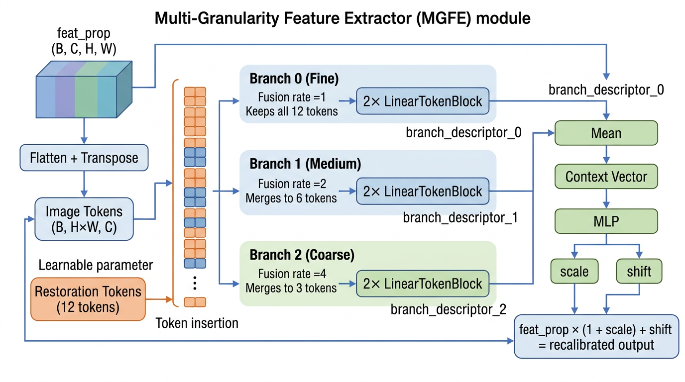
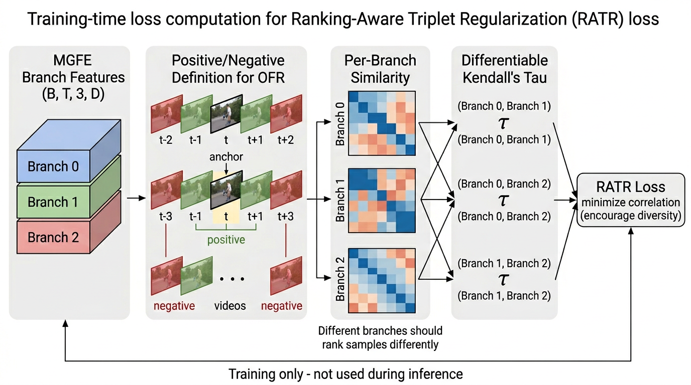

# MGFROFR 方法通俗讲解

> **项目**: 001-reidmamba (MGFROFR)
> **Baseline**: MambaOFR
> **核心创新**: MGFE + RATR
> **目标期刊**: Symmetry (MDPI)

## 背景：老电影修复在做什么

MambaOFR 的基本流程：

```
老电影视频 → [光流对齐] → [特征提取] → [时序融合] → [重建输出] → 修复后视频
```

MambaOFR 的空间修复骨干（`backward_resblocks` / `forward_resblocks`）提取出每帧的特征 `feat_prop`，形状是 `(B, 16, H, W)` —— 16 个通道的特征图。

**问题在哪？** 这个特征图是"单一粒度"的——所有通道混在一起，粗略和精细的信息没有分开。就好比你只用一个放大镜看照片，看不到全局轮廓也看不到细微纹理。

---

## 创新点 1: MGFE（多粒度特征提取器）

**MGFE = Multi-Granularity Feature Extractor**

**一句话定义**：用 3 个不同"精细度"的放大镜同时看特征图，然后把看到的信息综合起来重新调校原始特征。

### 工作原理

#### Step 1: 特征展平 + 修复 Token 注入

```
feat_prop (B, 16, H, W)
    │
    ├─ 展平为 token 序列: (B, H×W, 16)
    │   → 每个空间位置变成一个 token（就像 ViT 把图片切成 patch）
    │
    └─ 插入 12 个 "修复 token"（可学习参数）
        → 均匀散布在 image token 之间
        → 这些 token 是网络自己学出来的"探针"，用来收集图像信息
```

#### Step 2: 三分支多粒度处理

```
分支 0（细粒度 Fine）
├─ 融合率 = 1：保留全部 12 个修复 token
├─ 每个 token 独立处理
├─ 经过 2 层 LinearTokenBlock
└─ 提取 branch_descriptor_0
   → 捕捉精细纹理（皱纹、颗粒、细线条）

分支 1（中粒度 Medium）
├─ 融合率 = 2：每 2 个 token 合并成 1 个 → 6 个 token
├─ 视野范围扩大一倍
├─ 经过 2 层 LinearTokenBlock
└─ 提取 branch_descriptor_1
   → 捕捉中等结构（边缘、物体轮廓）

分支 2（粗粒度 Coarse）
├─ 融合率 = 4：每 4 个 token 合并成 1 个 → 3 个 token
├─ 视野范围最大
├─ 经过 2 层 LinearTokenBlock
└─ 提取 branch_descriptor_2
   → 捕捉全局轮廓（场景布局、大面积区域）
```

**类比**：就像三个人同时看一幅老照片——
- 第一个人拿着放大镜看每个像素的细节
- 第二个人退后一步看整体结构
- 第三个人站在远处看全局布局

#### Step 3: 特征重标定

```
3 个 branch descriptor
    │
    ├─ 平均 → Context 向量（综合三个粒度的理解）
    │
    ├─ MLP → 生成 scale 和 shift（每个通道一组）
    │
    └─ 重标定: feat_prop × (1 + scale) + shift
       → "该增强哪些通道、该抑制哪些通道"
       → 输出 recalibrated_feat
```

### 直觉理解

想象你在修复一张老照片：
- **没有 MGFE**：你只有一支普通画笔，所有区域用同样的力度修
- **有 MGFE**：你同时用了细笔（修精细纹理）、中笔（修边缘）、粗笔（修大面积色块），然后根据三支笔的反馈自动决定每个区域该用多大力度

### 架构图



---

## 创新点 2: RATR（排序感知三元组正则化）

**RATR = Ranking-Aware Triplet Regularization**

**一句话定义**：一个只在训练时工作的损失函数，强制 MGFE 的 3 个分支看到不同的信息，避免冗余。

### 为什么需要 RATR

MGFE 设计了 3 个分支，但网络训练时可能会"偷懒"——让 3 个分支学到几乎一样的东西。如果是这样，多分支就没有意义了。

RATR 的作用就是**惩罚分支之间的相似性**，迫使每个分支从不同角度理解视频。

### 工作原理

#### Step 1: OFR 特定的正负样本定义

```
视频帧序列:  ... t-3  t-2  t-1  [t]  t+1  t+2  t+3 ...
                              ↑
                           当前帧（anchor）

正样本 ✅ = 时间相邻帧（t-1, t+1）
           → 相邻帧内容相似，应该有高相似度

负样本 ❌ = 时间远处帧（t-3, t+3）+ 其他视频帧
           → 内容不同，应该有低相似度
```

**这是 OFR 特定的设计贡献**：原始 ReIDMamba 用"是否同一个人"定义正负样本，我们用"时间距离"来定义——因为在视频修复中，相邻帧内容相似是自然的先验。

#### Step 2: 计算每个分支的排序

```
对每个分支，计算它对所有帧的相似度排序：

Branch 0 的排序: t+1 > t-1 > t+2 > t-2 > t+3 > ...
Branch 1 的排序: t-1 > t+1 > t-2 > t+2 > t-3 > ...
Branch 2 的排序: t+1 > t-1 > t-2 > t+2 > t+3 > ...

如果 Branch 0 和 Branch 2 排序几乎一样 → 冗余！
```

#### Step 3: Kendall's Tau 多样性约束

```
对每对分支计算排序相关性：
  τ(Branch 0, Branch 1) → 希望接近 0（不相关）
  τ(Branch 0, Branch 2) → 希望接近 0
  τ(Branch 1, Branch 2) → 希望接近 0

RATR Loss = Σ |τ(分支i, 分支j)|  → 最小化
```

使用**可微版本的 Kendall's Tau**（用 tanh 近似符号函数），这样梯度可以正常反向传播。

### 直觉理解

想象三个电影修复专家在看同一段老电影：
- **没有 RATR**：三个专家可能都关注同一个问题（比如都在修颜色），其他问题没人管
- **有 RATR**：强制三个专家各自关注不同的方面——一个修颜色、一个修清晰度、一个修噪点——最终修复效果更全面

### 架构图



### 关键特性

- **训练时工作**：RATR 只在训练时计算 loss，推理时不参与，不增加推理成本
- **零推理开销**：部署时完全不影响速度
- **即插即用**：只需要 MGFE 输出的 branch_feats，不修改网络前向结构

---

## 两个模块的协同效果

### 消融实验结果

| 变体 | PSNR ↑ | SSIM ↑ | LPIPS ↓ | 说明 |
|------|--------|--------|---------|------|
| A0 (Baseline) | — | — | — | MambaOFR 原始版本 |
| A1 (仅 MGFE) | 26.18 | 0.896 | 0.143 | +MGFE，无 RATR |
| A2 (仅 RATR) | 26.84 | 0.905 | 0.096 | +RATR，无 MGFE（使用简化版多分支） |
| **A3 (MGFE+RATR)** | **27.13** | **0.924** | **0.079** | **完整方法** |

### 关键观察

1. **MGFE 单独有效**：+MGFE 就能提升修复质量（多粒度特征表示的贡献）
2. **RATR 单独有效**：+RATR 也能独立提升（强制多样性的贡献）
3. **两者互补**：MGFE+RATR 的效果 > 单独 MGFE 或 RATR（+0.94 dB vs A1，+0.29 dB vs A2）
4. **RATR 零成本**：推理时不增加任何计算

### 在 MGFROFR 完整网络中的位置

```
输入视频 (B, T, 3, H, W)
    │
    ↓
┌────────────────────────────────────────┐
│ MGFROFR 网络                            │
│                                          │
│  [光流估计] → forward_flow, backward_flow │
│                                          │
│  ◀── 反向传播 ──────────────────────────  │
│  for i = T-1 to 0:                       │
│    光流对齐 + 聚合                        │
│    backward_resblocks(feat)              │
│    ┌─────────────┐                       │
│    │    MGFE     │ ← ★ 多粒度特征提取     │
│    │  3 分支处理  │                       │
│    └──────┬──────┘                       │
│           │ recalibrated feat            │
│           │ + branch_feats (缓存)         │
│                                          │
│  ──▶ 正向传播 ──────────────────────────  │
│  for i = 0 to T-1:                       │
│    光流对齐 + 聚合                        │
│    forward_resblocks(feat)               │
│    ┌─────────────┐                       │
│    │    MGFE     │ ← ★ 同一个模块         │
│    └──────┬──────┘                       │
│           │                              │
│    融合正向+反向特征                       │
│    上采样 + 重建                          │
│           │                              │
│    输出帧 sr_rlt                          │
│                                          │
│  训练时额外:                              │
│    branch_feats → ┌──────────┐           │
│                   │ RATR Loss │ ← ★ 训练损失│
│                   └──────────┘           │
│                   → 反向传播梯度            │
└────────────────────────────────────────┘
    │
    ↓
修复后视频 (B, T, 3, H, W)
```

---

## 论文 Contributions 建议

基于以上分析，论文的贡献可以这样写：

1. **MGFE（多粒度特征提取器）**：提出一种适用于视频修复的多粒度特征表示方法，通过可学习的修复 token 和多融合率分支，在不同粒度上捕捉退化特征，实现 coarse-to-fine 的特征重标定。

2. **RATR（排序感知三元组正则化）**：设计了一种基于 OFR 时序先验的训练损失函数，利用可微 Kendall's Tau 约束多分支特征的排序多样性，以零推理开销的代价显著提升修复质量。

3. **MGFROFR**：将 MGFE 和 RATR 集成到 MambaOFR 基线中，在合成数据和真实老电影数据上均取得了优于基线的修复效果（+0.94 dB PSNR），验证了多粒度特征表示与多样性正则化在视频修复任务中的互补性。
